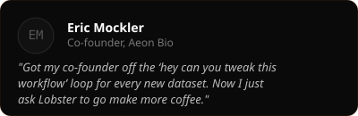
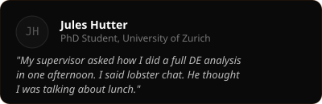
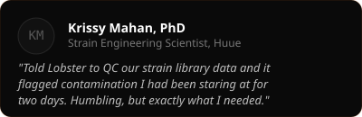
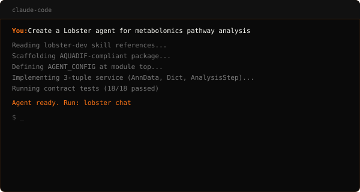
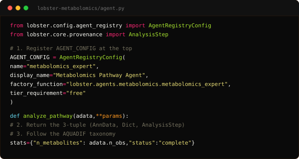

<div align="center">
  
</div>

<br/>

<div align="center">
  <table border="0" cellspacing="6" cellpadding="0" style="border: none; background: transparent;">
    <tr>
      <td style="border: none; background: transparent;"><a href="https://docs.omics-os.com"></a></td>
      <td style="border: none; background: transparent;"><a href="https://app.omics-os.com"></a></td>
      <td style="border: none; background: transparent;"><a href="https://pypi.org/project/lobster-ai/"></a></td>
    </tr>
  </table>
</div>

<br/>

<div align="center">
  <table border="0" cellspacing="0" cellpadding="8" style="border: none; background: transparent;">
    <tr>
      <td style="border: none; background: transparent;"></td>
      <td style="border: none; background: transparent;"></td>
      <td style="border: none; background: transparent;"></td>
    </tr>
  </table>
</div>

<br/>

---

简体中文：[README.zh.md](https://github.com/the-omics-os/lobster/blob/main/README.zh.md) · 命令行加上 `--lang zh`，或设置 `LOBSTER_LANG=zh`。

# Quickstart

**1. Install Lobster AI (macOS/Linux):**
```bash
curl -fsSL https://install.lobsterbio.com -o install.sh && bash install.sh
```
*(Download first, then run: the installer asks interactive questions that a piped `curl | bash` cannot read. Windows users: `irm https://install.lobsterbio.com/windows | iex`)*

Prefer to install it yourself? With `uv` (or `pip`):
<!-- VERIFY: plain lobster-ai includes the default provider, and lobster init installs the chosen analysis packages under uv tool. Remove this comment before publication. -->
```bash
uv tool install --python 3.12 lobster-ai    # or in a virtual environment: uv venv --python 3.12, then uv pip install lobster-ai
```
The plain install is small and includes the default provider, Omics-OS Cloud. `lobster init` (step 2) asks which analysis packages and which other providers to install, so you only install what you use. Python 3.12 or 3.13.

**2. Set up a project folder** (skip if you already chose a provider during install):
```bash
lobster init ~/my-study    # any subfolder; your home folder itself is refused
cd ~/my-study
```
Pick a provider — Omics-OS Cloud (managed, API key from [app.omics-os.com/account](https://app.omics-os.com/account)), Anthropic, Gemini, or a local Ollama — and the analysis packages you need.

A **project** is a folder whose hidden `.lobster_workspace/` holds `project.json` next to its provider, model and expert settings. Lobster finds the project from the folder you run it in (it walks up; the first `.lobster_workspace` wins), so every run, chat and MCP call inside it uses the same setup. `lobster projects list | info | delete` manage projects (`--json` on each); `delete` removes only what Lobster created, never your folder, and `--dry-run` shows what would go. Running `lobster init` again changes the settings and keeps the project's identity.

Non-interactive setup (agents, CI, scripts):
```bash
export OMICS_OS_API_KEY="..."             # from app.omics-os.com/account
lobster init --non-interactive --global --use-omics-os --preset scrna-basic   # installs the preset's packages
lobster status                            # shows configuration, not account proof
lobster config-test --json                # optional: one real connectivity check
```

<details>
<summary><b>Watch: installation & init walkthrough</b></summary>
<br/>
<div align="center">
  
</div>
</details>

**3. Start an interactive session:**
```bash
lobster chat
```
Then describe your analysis in plain language:
```text
> Search PubMed for single-cell CRISPR screens in T cells from 2023–2024,
  download the most cited dataset, run QC, integrate batches with Harmony,
  cluster the cells, annotate cell types, and export a notebook of the recorded steps.
```

<details>
<summary><b>Watch: analysis session walkthrough</b></summary>
<br/>
<div align="center">
  
</div>
</details>

<br/>

# Use Lobster from Claude Code, Claude Desktop and Codex (MCP)

`lobster mcp --stdio` runs Lobster as an [MCP](https://modelcontextprotocol.io) server on stdin and stdout, so a coding agent or desktop app can hand it an experimental question and get back a result, a notebook and files. It needs Lobster installed locally (the `lobster` command on your PATH) and a project with a provider set up (`lobster init my-project`, above).

The server has nine tools: `lobster_overview`, `lobster_run`, `lobster_status`, `lobster_wait`, `lobster_answer`, `lobster_cancel`, `lobster_continue`, `lobster_inspect` and `lobster_docs`. The host calls `lobster_overview` first: it reports the project, provider, model, whether a key is present (never the key), the project's experts, data files and past runs. A run takes a free-text question and an optional local file.

**Claude Code** — one command, or a `.mcp.json` in your project:
```bash
claude mcp add --transport stdio lobster -- lobster mcp --stdio
```
```json
{
  "mcpServers": {
    "lobster": {
      "type": "stdio",
      "command": "lobster",
      "args": ["mcp", "--stdio"]
    }
  }
}
```

**Claude Desktop** — add to `claude_desktop_config.json` (macOS: `~/Library/Application Support/Claude/`):
```json
{
  "mcpServers": {
    "lobster": {
      "command": "lobster",
      "args": ["mcp", "--stdio"]
    }
  }
}
```

**Codex** — add to `~/.codex/config.toml` ([full file](https://github.com/the-omics-os/lobster/blob/main/lobster/integrations/codex.config.toml), which also lists every provider key Codex can forward):
```toml
[mcp_servers.lobster]
command = "lobster"
args = ["mcp", "--stdio"]
startup_timeout_sec = 60
tool_timeout_sec = 120
env_vars = ["ANTHROPIC_API_KEY"]   # Codex passes only listed variables to the server
```

Desktop apps do not start from your shell: replace `"lobster"` with the absolute path from `which lobster`, and add `"--workspace", "/path/to/my-project"` to `args` so the server finds your project (Codex: set `cwd` instead). Configurations for Cursor and Open Science are in [`lobster/integrations`](https://github.com/the-omics-os/lobster/tree/main/lobster/integrations).

Before anything else runs, a run that is given a file loads and describes it, writes a short plan and puts the plan to the host as a question; the host shows it to you and answers with `lobster_answer`. Over MCP the host reports whether you or the host agent answered; Lobster records that as reported and cannot verify it. The server reads your provider key from its own environment (the `env` block of the host's MCP configuration), the global credentials file or the project's `.env`; it never puts a key in the project.

<br/>

# CLI Reference

**Core commands:**
```bash
lobster chat                        # Interactive session (default)
lobster query "your request"        # Single-turn, non-interactive
lobster init [folder]               # Configure LLM provider and API keys; a folder makes a project
lobster projects list               # Projects Lobster knows about
lobster replay --verify nb.ipynb    # Re-run an exported notebook and compare its output
lobster mcp --stdio                 # MCP server for coding agents and desktop apps
lobster --help                      # Full command reference
```

**Session continuity:**
```bash
lobster query --session-id my_project "Search PubMed for CRISPR"
lobster query --session-id latest "Download the first result"  # resume last session
```

**In-session slash commands** (inside `lobster chat`):
```text
> /pipeline export                  # Export the recorded analysis steps as a Jupyter notebook
> /pipeline run analysis.ipynb      # Re-run an exported notebook
> /data                             # List loaded datasets and modalities
> /files                            # Browse workspace files
> /status                           # Session info, token usage, active agents
> /help                             # All slash commands
```

**Developer commands:**
```bash
lobster scaffold agent --name my_expert --display-name "My Expert" \
  --description "Description"               # Generate a new agent package
lobster validate-plugin ./lobster-my/       # Validate package structure and AQUADIF contract
```

<br/>

# 🤖 For AI Coding Agents

Install skills that give Claude Code, Cursor, or Gemini CLI deep knowledge of the Lobster architecture:
```bash
curl -fsSL https://skills.lobsterbio.com | bash
```
This installs `lobster-use` (analysis workflows) and `lobster-dev` (agent development). With these loaded, your coding agent understands the package structure, tool patterns, entry point registration, and AQUADIF contract — without needing to read source code manually. The same skills ship inside the package: `lobster skills list` shows them and `lobster skills install` copies them into the skill folders of the coding agents you have.

To let your coding agent *run* analyses rather than write code, connect it through MCP (see above).

**Scaffold a new agent package from the command line:**
```bash
lobster scaffold agent \
  --name epigenomics_expert \
  --display-name "Epigenomics Expert" \
  --description "ATAC-seq, ChIP-seq, and DNA methylation analysis"
```
Generates a complete, contract-compliant package: `pyproject.toml`, entry point wiring, tool stubs with AQUADIF metadata, and contract tests. Then point your coding agent at the generated scaffolding and ask it to implement the domain logic.

<br/>

# Use Cases

End-to-end walkthroughs across omics domains:

<table width="100%" style="border: none; background: transparent;">
  <thead>
    <tr>
      <th align="left">Domain</th>
      <th align="left">Case Study</th>
    </tr>
  </thead>
  <tbody>
    <tr><td>Single-Cell Transcriptomics</td><td><a href="https://docs.omics-os.com/docs/case-studies/transcriptomics/">Cell clustering, annotation &amp; trajectory inference</a></td></tr>
    <tr><td>CML Drug Resistance</td><td><a href="https://docs.omics-os.com/docs/case-studies/cml-resistance/">Resistance mechanism discovery from scRNA-seq</a></td></tr>
    <tr><td>Drug Discovery</td><td><a href="https://docs.omics-os.com/docs/case-studies/drug-discovery/">Target identification &amp; compound prioritization</a></td></tr>
    <tr><td>Clinical Genomics</td><td><a href="https://docs.omics-os.com/docs/case-studies/genomics/">Variant annotation &amp; GWAS analysis</a></td></tr>
    <tr><td>Mass Spec Proteomics</td><td><a href="https://docs.omics-os.com/docs/case-studies/proteomics/">Biomarker panel selection from DIA-NN data</a></td></tr>
    <tr><td>Literature Mining</td><td><a href="https://docs.omics-os.com/docs/case-studies/research/">Automated dataset discovery from PubMed</a></td></tr>
    <tr><td>Multi-Omics ML</td><td><a href="https://docs.omics-os.com/docs/case-studies/machine-learning/">Feature selection &amp; survival analysis</a></td></tr>
  </tbody>
</table>

<br/>

# Check an exported notebook: `lobster replay --verify`

```bash
lobster replay --verify analysis.ipynb --input my_data.h5ad
```
`lobster replay --verify` runs an exported notebook again and compares what it writes against the files the session saved. It detects changes it can see; it does not prove how the outputs were computed. Only `.h5ad` and `.h5mu` outputs are compared; other files are listed. The replay starts from the file the session loaded (Lobster records its SHA-256 and size), so give it with `--input`; for a GEO download the saved raw file is used and `--input` is optional. Verdicts:

* **MATCH** (exit 0): every saved file was compared and equal, every reference still has the bytes recorded at session time, and the notebook changed no data file in the workspace.
* **MISMATCH** (exit 1): a compared output differs from the file the session saved.
* **REFUSED** (exit 4): the replay will not call itself a match, for example the input is not a file the session loaded, or a reference file changed or is missing.
* **NOT_COMPARED** (exit 3): nothing, or not enough, could be compared. Notebooks exported before 1.3 carry no input record (export them again), and sessions migrated from Lobster 1.2.x always end here.

A notebook that fails to run exits 5. Plot cells run, but figures are not compared.

<br/>

# Optional: LaminDB catalog

Lobster can record its work in a [LaminDB](https://lamin.ai) catalog inside your workspace: sessions, the datasets you save (with versions and content hashes), exported notebooks and a step log. It is **off by default**; with it off, Lobster does not import LaminDB. It needs the optional `[lamin]` extra, which `lobster init` installs at its LaminDB step:
<!-- VERIFY: lobster init --lamin installs the [lamin] extra through uv tool install --with. Remove this comment before publication. -->
```bash
lobster init ~/my-study --lamin         # installs the extra and switches the catalog on for that project
cd ~/my-study                           # the lamin commands below act on the project you are in
lobster lamin init                      # or switch it on later in an existing workspace
lobster lamin status                    # where the catalog is and what it holds
lobster lamin ls --runs                 # recorded sessions (add --json for data)
```
By default the catalog is a local SQLite database in `<workspace>/.lamindb/`; it needs no account and no server. Chat prompts and model replies are not recorded. In a project, one catalog holds every run; keep `.lamindb/` out of a shared repository. If the catalog is on and the extra is missing, Lobster logs a warning and runs without recording; if the catalog fails, Lobster keeps working. The extra is not part of `[full]`.

<br/>

# 🧠 Architecture

Lobster AI is a multi-agent system: specialist agents for each omics domain, orchestrated by a LangGraph supervisor.

* **Local execution:** Analysis runs on your machine. Your data files stay on your machine; messages and tool results are sent to the LLM provider you configure (with a local model such as Ollama, they stay on your machine too).
* **Scientific libraries:** Agents call Scanpy, PyDESeq2, Harmony and others through tool functions. Some agents also have a code tool for custom analysis, which you can switch off per agent.
* **Provenance:** Analysis steps are recorded and can be exported as a Jupyter notebook. Decisions Lobster asks you to make are recorded with the answer and who gave it (`human` or `model`).

<div align="center">
  
  <br/><br/>
  
</div>

<br/>

# 🛠️ Build Your Own Agent

New agents are standalone packages that plug into Lobster via Python entry points. The `lobster-dev` skill loads the full architecture reference into your coding agent (Claude Code, Gemini CLI, Cursor) — package layout, tool patterns, AQUADIF contract, and test fixtures. Use `lobster scaffold` to generate the package skeleton, then let your coding agent implement the domain logic.

<div align="center">
  <table border="0" cellspacing="0" cellpadding="12">
    <tr>
      <td valign="top" align="center">
        <b>1. The Request</b><br/><br/>
        
      </td>
      <td valign="top" align="center">
        <b>2. The Result</b><br/><br/>
        
      </td>
    </tr>
  </table>
</div>

<br/>

# FAQ

<details>
<summary><b>What omics domains are supported?</b></summary>

| Domain | Input Formats | Key Capabilities |
|--------|--------------|-----------------|
| **Single-Cell RNA-seq** | AnnData, 10x, h5ad | QC, doublet detection (Scrublet), batch integration (Harmony/scVI), clustering, cell type annotation, trajectory inference (DPT/PAGA) |
| **Bulk RNA-seq** | Salmon, kallisto, featureCounts | Sample QC, normalization (DESeq2/VST/CPM), differential expression (PyDESeq2), GSEA, publication-ready export |
| **Genomics** | VCF, PLINK | GWAS, LD pruning, kinship estimation, association testing, result clumping |
| **Clinical Genomics** | VCF, ClinVar, gnomAD | Variant annotation (VEP), pathogenicity scoring, clinical variant prioritization |
| **Mass Spec Proteomics** | MaxQuant, DIA-NN, Spectronaut | PTM analysis (phospho/acetyl/ubiquitin), peptide-to-protein rollup, batch correction |
| **Affinity Proteomics** | Olink NPX, SomaScan ADAT, Luminex MFI | LOD quality filtering, bridge normalization, cross-platform concordance |
| **Proteomics Downstream** | Any loaded proteomics modality | GO/Reactome/KEGG enrichment, kinase enrichment (KSEA), STRING PPI, biomarker panel selection (LASSO/Boruta) |
| **Metabolomics** | LC-MS, GC-MS, NMR | QC (RSD/TIC), imputation, normalization (PQN/TIC/IS), PCA, PLS-DA, OPLS-DA, m/z annotation (HMDB/KEGG), lipid class analysis |
| **Machine Learning** | Any modality | Feature selection (stability/LASSO/variance), survival analysis (Cox/KM), cross-validation, SHAP, multi-omics integration (MOFA) |
| **Research & Data Access** | — | PubMed/GEO/PRIDE/MetaboLights search, dataset download orchestration, metadata harmonization |
</details>

<details>
<summary><b>Which LLMs can I use?</b></summary>

Configure via `lobster init` or environment variables. All providers use the same agent interface.

| Provider | Type | Setup | Notes |
|----------|------|-------|-------|
| **Anthropic** | Cloud | API key | Claude models — recommended default |
| **Ollama** | Local | `ollama pull <model>` | Local model: no messages go to an LLM provider (online database searches still use the internet) |
| **OpenAI** | Cloud | API key | GPT and o-series models |
| **OpenRouter** | Cloud | API key | Many models behind a single endpoint |
| **Nebius AI Studio** | Cloud | API key | Open-weight models (Qwen, DeepSeek, GLM, Kimi) |
| **Google Gemini** | Cloud | Google API key | Long context window |
| **AWS Bedrock** | Cloud | AWS credentials | Enterprise compliance, IAM-based auth |
| **Azure AI** | Cloud | Endpoint + credential | Azure-hosted deployments |
</details>

<details>
<summary><b>Pipeline export and slash commands</b></summary>

```text
lobster chat
> /pipeline export         # Export a Jupyter notebook of the recorded steps
> /pipeline list           # List exported pipelines
> /pipeline run analysis.ipynb geo_gse109564
> /data                    # Show loaded datasets
> /status                  # Session info
> /help                    # All commands
```

Headless re-runs: execute the exported notebook with Papermill — only names in the
notebook's parameters cell can be overridden:
```bash
papermill analysis.ipynb output.ipynb -p input_data "new_dataset.h5ad"
```
</details>

<details>
<summary><b>Advanced installation (Windows, pip)</b></summary>

**Windows** (PowerShell):
```powershell
irm https://install.lobsterbio.com/windows | iex
```

**uv** (recommended manual install):
```bash
uv tool install --python 3.12 lobster-ai
lobster init ~/my-study              # asks which analysis packages and providers to install
cd ~/my-study                        # run Lobster from inside the project
```

**Everything at once** (a larger install): `uv tool install --python 3.12 'lobster-ai[full]'` installs all bundled
domains (transcriptomics, genomics, proteomics), the metadata assistant and every provider package.

Optional domains ship as separate packages — add them to the same tool environment:
```bash
uv tool install --python 3.12 lobster-ai --with lobster-metabolomics --with lobster-ml \
  --with lobster-drug-discovery --with lobster-structural-viz
```
Re-running `uv tool install` rebuilds the tool environment: extras and `--with` packages
reset to whatever the new command includes — list them again when upgrading.

**Virtual environment** (uv or pip):
<!-- VERIFY: plain lobster-ai includes the default provider, and lobster init installs the chosen analysis packages under uv tool. Remove this comment before publication. -->
```bash
uv venv --python 3.12 .venv && source .venv/bin/activate
uv pip install lobster-ai    # a uv venv has no pip; without uv: python3.12 -m venv .venv, activate, pip install lobster-ai
lobster init ~/my-study      # a project folder, not your home folder
cd ~/my-study                # run Lobster from inside the project
```
Optional extra for the workspace catalog: `lobster-ai[lamin]` (see above).

**Upgrade**:
```bash
uv tool upgrade --python 3.12 lobster-ai    # uv tool: also upgrades the packages installed with it (--with)
```
In a virtual environment, name every installed `lobster-*` package, or the agent packages stay on the old version
(list them with `uv pip list --python .venv/bin/python | grep lobster`):
```bash
uv pip install --python .venv/bin/python -U lobster-ai lobster-research lobster-transcriptomics   # the lobster-* packages you have
```
</details>

<details>
<summary><b>How do I build my own agent?</b></summary>

Agents are standalone Python packages that register via PEP 517 entry points. No changes to core required — Lobster discovers them automatically at startup.

**1. Scaffold the package:**
```bash
lobster scaffold agent \
  --name my_domain_expert \
  --display-name "My Domain Expert" \
  --description "Analysis for [your domain]"
```

**2. Implement your tools** in the generated `tools/` directory. Each tool must declare AQUADIF metadata:
```python
@tool
def run_analysis(modality_name: str) -> str:
    """Run domain-specific analysis on a loaded modality."""
    ...

run_analysis.metadata = {"categories": ["ANALYZE"], "provenance": True}
run_analysis.tags = ["ANALYZE"]
```

**3. Validate the package structure** before wiring:
```bash
lobster validate-plugin ./lobster-my_domain/
```

**4. Install and test:**
```bash
cd lobster-my_domain && uv venv --python 3.12 .venv && source .venv/bin/activate
uv pip install -e . pytest
pytest -m contract  # runs all AQUADIF contract checks
```

Install the `lobster-dev` skill to give your coding agent the complete reference — package layout, `AGENT_CONFIG` pattern, factory function signature, tool design rules, and the full validation checklist:
```bash
curl -fsSL https://skills.lobsterbio.com | bash
```
</details>

<br/>

# Acknowledgements

<table border="0" cellspacing="0" cellpadding="10" style="border: none; background: transparent;">
  <tr>
    <td style="border: none; background: transparent;">
      <a href="https://github.com/celltype/cli">
        
      </a>
    </td>
    <td style="border: none; background: transparent; vertical-align: middle;">
      Structural inspiration for the drug discovery agent package — CLI design patterns and domain decomposition.
    </td>
  </tr>
  <tr>
    <td style="border: none; background: transparent;">
      <a href="https://github.com/GPTomics/bioSkills">
        
      </a>
    </td>
    <td style="border: none; background: transparent; vertical-align: middle;">
      Foundation for the <code>lobster-use</code> and <code>lobster-dev</code> skills — domain knowledge structure and skill distribution patterns.
    </td>
  </tr>
  <tr>
    <td style="border: none; background: transparent;">
      <a href="https://github.com/assistant-ui/assistant-ui">
        
      </a>
    </td>
    <td style="border: none; background: transparent; vertical-align: middle;">
      UI component architecture and streaming patterns used in the Omics-OS Cloud frontend.
    </td>
  </tr>
  <tr>
    <td style="border: none; background: transparent;">
      <a href="https://github.com/charmbracelet">
        
      </a>
    </td>
    <td style="border: none; background: transparent; vertical-align: middle;">
      BubbleTea, Lipgloss, Glamour, and huh — the entire terminal UI stack powering <code>lobster chat</code>.
    </td>
  </tr>
</table>

<br/>

<div align="center">
  <b>Multi-omics data infrastructure for foundation models &amp; biotech.</b><br/><br/>
  <a href="https://omics-os.com">Omics-OS</a> &nbsp;·&nbsp; <a href="https://lobsterbio.com">Lobster AI</a> &nbsp;·&nbsp; <a href="https://docs.omics-os.com">Docs</a>
</div>
