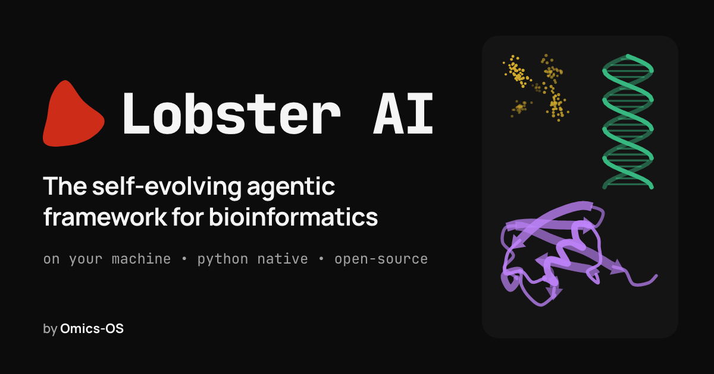
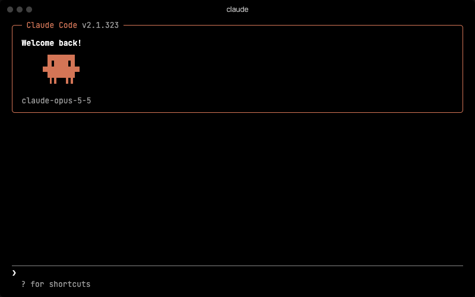
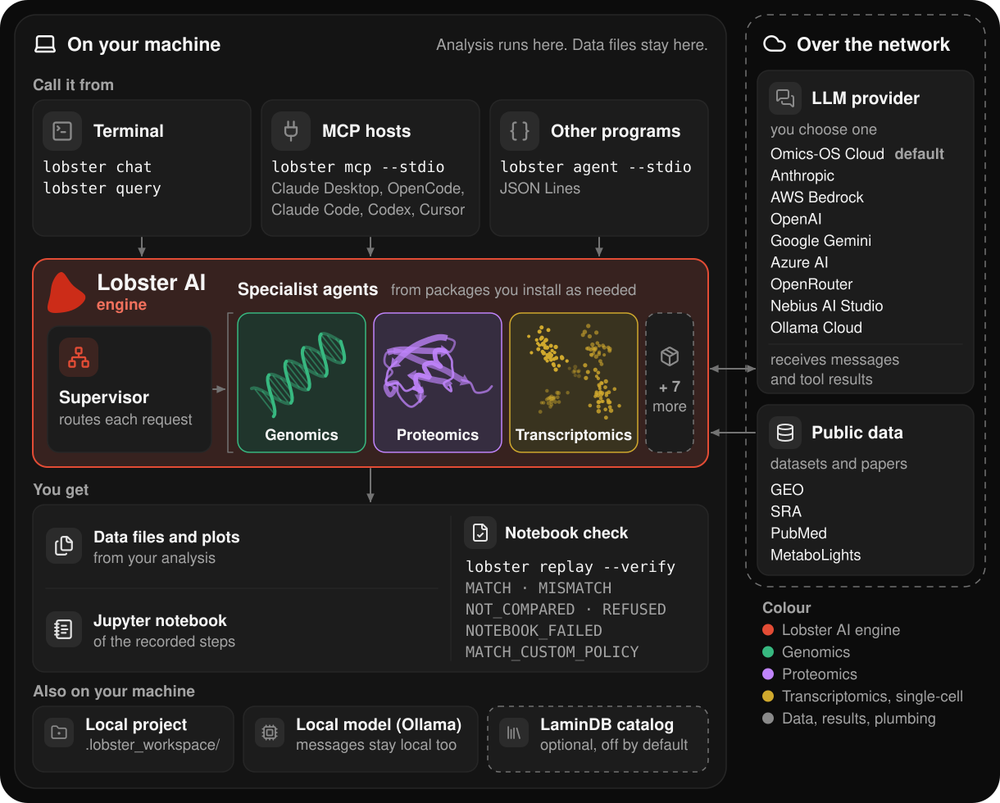
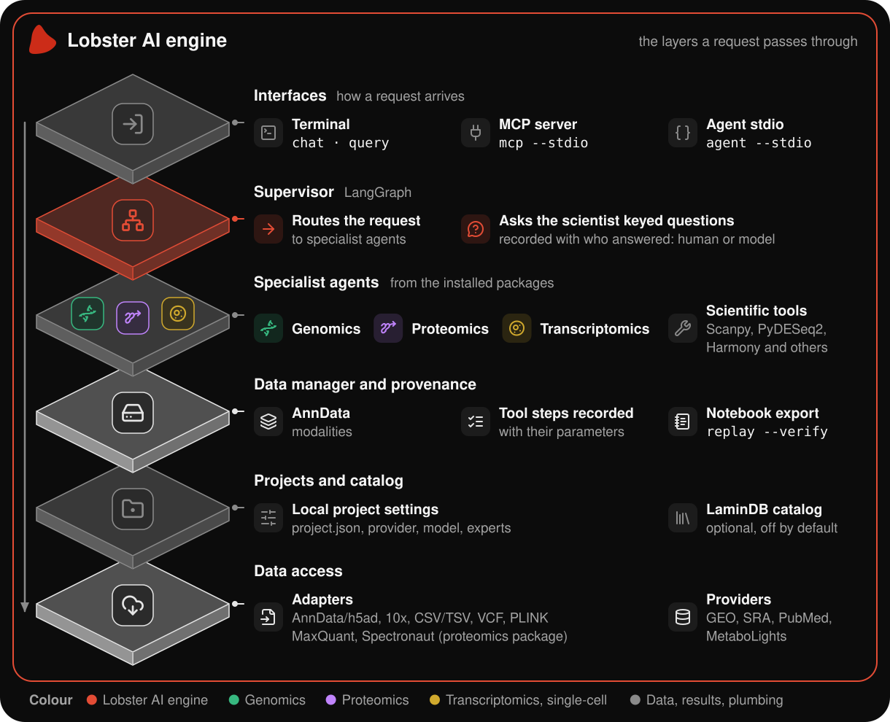

<div align="center">
  
</div>

<br/>

<div align="center">
  <table border="0" cellspacing="6" cellpadding="0" style="border: none; background: transparent;">
    <tr>
      <td style="border: none; background: transparent;"><a href="https://docs.omics-os.com"></a></td>
      <td style="border: none; background: transparent;"><a href="https://app.omics-os.com"></a></td>
      <td style="border: none; background: transparent;"><a href="https://pypi.org/project/lobster-ai/"></a></td>
    </tr>
  </table>
</div>

<br/>

**Lobster AI** is an open-source multi-agent system for bioinformatics. Describe an analysis in plain language: specialist agents for each omics domain find and load the data, run the analysis with scientific libraries such as Scanpy and PyDESeq2, and record the analysis steps, which you can export as a Jupyter notebook. It runs on your machine, in its own terminal chat or from your coding agent over MCP.

简体中文：[README.zh.md](https://github.com/the-omics-os/lobster/blob/main/README.zh.md) · 命令行加上 `--lang zh`，或设置 `LOBSTER_LANG=zh`。

# Quickstart

**1. Install** (macOS and Linux):
```bash
curl -fsSL https://install.lobsterbio.com -o install.sh && bash install.sh
```
The installer asks a few questions, so download it first: a piped `curl | bash` cannot read the answers.

**Windows:** open PowerShell or Command Prompt, paste this line and press Enter. When it finishes, close the window, open a new one and type `lobster`.
```powershell
powershell -ExecutionPolicy ByPass -c "irm https://install.lobsterbio.com/windows | iex"
```
To install with `uv` or `pip`, add analysis packages later or upgrade, see the [installation guide](https://docs.omics-os.com/docs/getting-started/installation).

**2. Make a project:**
```bash
lobster init ~/my-study    # any folder below your home folder
cd ~/my-study
```
`lobster init` asks for your LLM provider and the analysis packages you need. The project keeps that setup next to your data and runs, so chats, runs and MCP calls in the folder use it: see [Lobster projects](https://docs.omics-os.com/docs/guides/lobster-projects). Setting up from an agent, CI or a script: [non-interactive setup](https://docs.omics-os.com/docs/getting-started/installation#non-interactive-setup-agents-ci-scripts).

**3. Ask in plain language:**
```bash
lobster chat
```
```text
> Load pbmc3k_raw.h5ad as pbmc3k and describe it.
> Filter cells with 200 to 2500 genes and under 5% mitochondrial counts, keep genes
  seen in at least 3 cells, then normalize to 10,000 counts per cell and log1p.
> Select 2000 highly variable genes, run PCA, cluster with Leiden, compute a UMAP
  and find marker genes for each cluster.
```

<div align="center">
  
  <br/>
  <sub>A replay of a real <code>lobster chat</code> session with Lobster AI 1.3.0: load PBMC 3k, filter and normalize, then cluster. Waits between steps are shortened.</sub>
</div>

<br/>

# Use Lobster from your coding agent (MCP)

`lobster mcp --stdio` runs Lobster as an [MCP](https://modelcontextprotocol.io) server. Claude Code, Claude Desktop, Codex, Cursor or OpenCode hands it an experimental question and gets back the result, a notebook and the files. In Claude Code, inside your project folder:
```bash
claude mcp add --transport stdio lobster -- lobster mcp --stdio
```
The configuration for the other hosts, the nine tools and how you approve Lobster's plan are in the [MCP guide](https://docs.omics-os.com/docs/guides/lobster-mcp).

<div align="center">
  
  <br/>
  <sub>A replay of a real run: Claude Code 2.1.323 asks Lobster AI 1.3.0 for public PBMC datasets on GEO. Waits between steps are shortened.</sub>
</div>

<br/>

# Notebooks, replay and the catalog

* **Export:** in `lobster chat`, `/pipeline export` writes the recorded analysis steps as a Jupyter notebook.
* **Check:** `lobster replay --verify analysis.ipynb --input my_data.h5ad` runs the notebook again and compares what it writes with the files the session saved. It detects changes it can see; it does not prove how the outputs were computed. See [replay and verify](https://docs.omics-os.com/docs/guides/replay-verify).
* **Catalog (optional, off by default):** with `lobster init ~/my-study --lamin`, Lobster records sessions, the datasets you save (with versions and content hashes) and exported notebooks in a local [LaminDB](https://lamin.ai) catalog in your workspace. See the [LaminDB catalog guide](https://docs.omics-os.com/docs/guides/lamindb-catalog).

<br/>

# CLI reference

```bash
lobster chat                        # Interactive session
lobster query "your request"        # One request, no chat
lobster init [folder]               # Set up a provider; a folder makes a project
lobster projects list               # Projects Lobster knows about
lobster replay --verify nb.ipynb    # Re-run an exported notebook and compare its output
lobster mcp --stdio                 # MCP server for coding agents and desktop apps
lobster --help                      # Every command
```
The other commands and the slash commands inside `lobster chat`: [CLI commands](https://docs.omics-os.com/docs/guides/cli-commands).

<br/>

# Agents and LLM providers

**Agents:** ten agent packages cover transcriptomics (single-cell and bulk RNA-seq), genomics, proteomics, metabolomics, machine learning, drug discovery, structural visualization, visualization, metadata, and research (literature and dataset search). Install only the ones you need: [agent packages](https://docs.omics-os.com/docs/agents).

**LLM providers:** Omics-OS Cloud (the default), Anthropic, AWS Bedrock, Google Gemini, OpenAI, OpenRouter, Nebius AI Studio, Azure AI and Ollama Cloud, or a local Ollama, where no messages go to an LLM provider (online database searches still use the internet). See [configuration](https://docs.omics-os.com/docs/getting-started/configuration).

**Case studies:** [single-cell transcriptomics](https://docs.omics-os.com/docs/case-studies/transcriptomics/) · [CML drug resistance](https://docs.omics-os.com/docs/case-studies/cml-resistance/) · [drug discovery](https://docs.omics-os.com/docs/case-studies/drug-discovery/) · [clinical genomics](https://docs.omics-os.com/docs/case-studies/genomics/) · [mass-spec proteomics](https://docs.omics-os.com/docs/case-studies/proteomics/) · [literature mining](https://docs.omics-os.com/docs/case-studies/research/) · [multi-omics ML](https://docs.omics-os.com/docs/case-studies/machine-learning/)

<br/>

# Architecture

Lobster AI is a multi-agent system: specialist agents for each omics domain, orchestrated by a LangGraph supervisor.

* **Local execution:** Analysis runs on your machine. Your data files stay on your machine; messages and tool results are sent to the LLM provider you configure (with a local model such as Ollama, they stay on your machine too).
* **Scientific libraries:** Agents call Scanpy, PyDESeq2, Harmony and others through tool functions. Some agents also have a code tool for custom analysis, which you can switch off per agent.
* **Provenance:** Analysis steps are recorded and can be exported as a Jupyter notebook. Decisions Lobster asks you to make are recorded with the answer and who gave it (`human` or `model`).

<div align="center">
  <picture>
    <source media="(prefers-color-scheme: dark)" srcset="https://raw.githubusercontent.com/the-omics-os/lobster/main/docs/assets/architecture-topology.svg">
    <source media="(prefers-color-scheme: light)" srcset="https://raw.githubusercontent.com/the-omics-os/lobster/main/docs/assets/architecture-topology-light.svg">
    
  </picture>
  <br/><br/>
  <picture>
    <source media="(prefers-color-scheme: dark)" srcset="https://raw.githubusercontent.com/the-omics-os/lobster/main/docs/assets/architecture-core.svg">
    <source media="(prefers-color-scheme: light)" srcset="https://raw.githubusercontent.com/the-omics-os/lobster/main/docs/assets/architecture-core-light.svg">
    
  </picture>
</div>

More in the [architecture overview](https://docs.omics-os.com/docs/architecture/overview).

<br/>

# Build your own agent

Agents are standalone Python packages that Lobster finds through entry points. `lobster scaffold agent` generates one with tool stubs, AQUADIF metadata and contract tests; `lobster validate-plugin` checks it. The `lobster-dev` skill gives your coding agent the package layout, the tool rules and the AQUADIF contract:
```bash
curl -fsSL https://skills.lobsterbio.com | bash    # also lobster-use, for analysis workflows
```
The same skills ship inside the package (`lobster skills list`, `lobster skills install`). Guide: [creating agents](https://docs.omics-os.com/docs/developer/creating-agents).

<br/>

# Acknowledgements

<table border="0" cellspacing="0" cellpadding="10" style="border: none; background: transparent;">
  <tr>
    <td style="border: none; background: transparent;">
      <a href="https://github.com/celltype/cli">
        
      </a>
    </td>
    <td style="border: none; background: transparent; vertical-align: middle;">
      Structural inspiration for the drug discovery agent package — CLI design patterns and domain decomposition.
    </td>
  </tr>
  <tr>
    <td style="border: none; background: transparent;">
      <a href="https://github.com/GPTomics/bioSkills">
        
      </a>
    </td>
    <td style="border: none; background: transparent; vertical-align: middle;">
      Foundation for the <code>lobster-use</code> and <code>lobster-dev</code> skills — domain knowledge structure and skill distribution patterns.
    </td>
  </tr>
  <tr>
    <td style="border: none; background: transparent;">
      <a href="https://github.com/assistant-ui/assistant-ui">
        
      </a>
    </td>
    <td style="border: none; background: transparent; vertical-align: middle;">
      UI component architecture and streaming patterns used in the Omics-OS Cloud frontend.
    </td>
  </tr>
  <tr>
    <td style="border: none; background: transparent;">
      <a href="https://github.com/charmbracelet">
        
      </a>
    </td>
    <td style="border: none; background: transparent; vertical-align: middle;">
      BubbleTea, Lipgloss, Glamour, and huh — the entire terminal UI stack powering <code>lobster chat</code>.
    </td>
  </tr>
</table>

<br/>

<div align="center">
  <b>Lobster AI is built by Omics-OS, The Operating System for Biology.</b><br/><br/>
  <a href="https://omics-os.com">Omics-OS</a> &nbsp;·&nbsp; <a href="https://lobsterbio.com">Lobster AI</a> &nbsp;·&nbsp; <a href="https://docs.omics-os.com">Docs</a>
</div>
