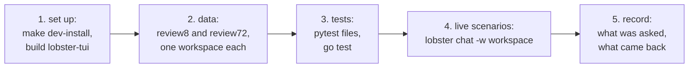
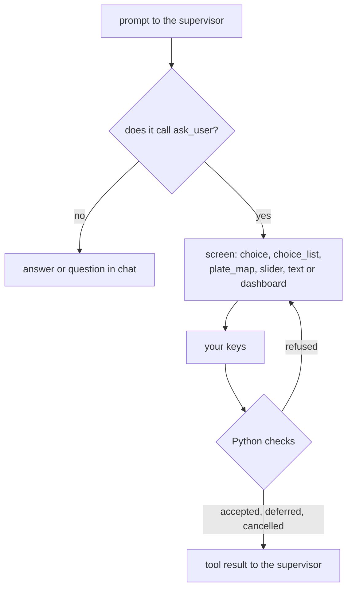
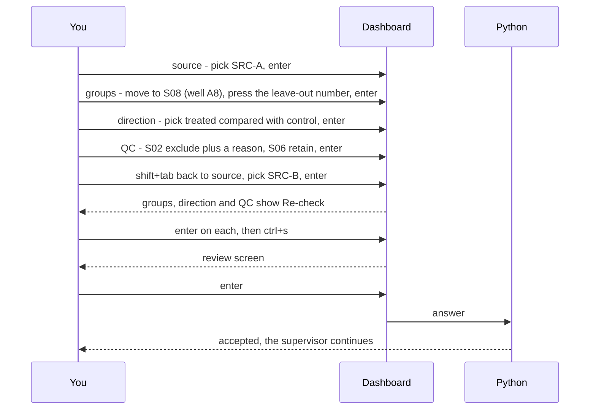

# Demo: dynamic decision components (v1) in the local Go TUI

This guide takes a clean clone to a running demo: build the Go TUI, make two fictional RNA-seq
datasets, run the tests, then ask the supervisor real questions and answer them on the new screens.
Every dataset here is synthetic and labelled FICTIONAL. The design is in
[`design.md`](design.md).

---

## Pictures first

### The whole demo



### What a scenario exercises



### An example: the dashboard scenario



---

## 1. Set up from a clean clone

You need bash on Linux or WSL2, `git`, `uv`, Go 1.26 or newer (`lobster-tui/go.mod`), and a key
for one LLM provider.

```bash
git clone https://github.com/the-omics-os/lobster.git
cd lobster
make dev-install                                # creates .venv with uv
```

Build the Go TUI from this checkout:

```bash
cd lobster-tui && go build -o lobster-tui ./cmd/lobster-tui && cd ..
export LOBSTER_TUI_BINARY="$PWD/lobster-tui/lobster-tui"
```

**Why `LOBSTER_TUI_BINARY`:** `lobster chat` looks for the TUI in this order: the
`LOBSTER_TUI_BINARY` path, then the binary inside an installed `lobster-ai-tui` package, then a
development build at `lobster-tui/lobster-tui`, then `~/.cache/lobster/bin`, then `PATH`. If a released
`lobster-ai-tui` is installed, its older binary wins over your fresh build. Setting the variable to the
absolute path removes the doubt.

**Provider key.** Put the key in your shell's environment without printing it, for example from a
`.env` file you keep outside the repository:

```bash
set -a; source <(grep '^ANTHROPIC_API_KEY=' /path/to/your/.env); set +a
[ -n "$ANTHROPIC_API_KEY" ] && echo "key loaded" || echo "key missing"
```

Use the variable your provider needs, and pass `--provider` (and `--model` if you like) to
`lobster chat`. The measurements behind this work used `--provider omics-os --model
global.anthropic.claude-sonnet-5-5`. Tracing is optional; to keep prompts and data out of any tracing
service, clear it:

```bash
unset LANGSMITH_API_KEY LANGSMITH_TRACING LANGSMITH_ENDPOINT LANGCHAIN_TRACING_V2 LANGCHAIN_API_KEY LANGCHAIN_ENDPOINT
```

**The Go TUI only runs without `--verbose` and `--reasoning`.** Either flag switches `lobster chat`
to the classic UI, which asks the same questions as plain-text prompts.

---

## 2. Make the data: one workspace per case

The prompts below say "syn_rnaseq". That word also matches the 72-sample files, which are named
`syn_rnaseq72_*`. If both cases sit in one workspace, the supervisor may mix them up. So **each case
gets its own workspace**:

```bash
uv run python docs/dynamic-ui/demo/make_synthetic_rnaseq.py ~/lobster-demo/review8
uv run python docs/dynamic-ui/demo/make_synthetic_rnaseq.py ~/lobster-demo/review72 --case review72
touch ~/lobster-demo/review8/.env ~/lobster-demo/review72/.env
```

The empty `.env` in each workspace keeps settings from picking up a `.env` file from somewhere else.
The files go into `<workspace>/data/`. The seeds are fixed, so a second run writes the same bytes.
Check them with:

```bash
(cd ~/lobster-demo/review8/data && sha256sum -c syn_rnaseq_checksums.sha256)
(cd ~/lobster-demo/review72/data && sha256sum -c syn_rnaseq72_checksums.sha256)
```

What is in each case:

| | `review8` (default) | `review72` |
|---|---|---|
| Samples | S01–S08 | S01–S72, batches B1 and B2 |
| Conditions | S01–S04 control, S05–S07 treated, **S08 unknown** | 34 control, 34 treated, **4 unknown: S15, S30, S49, S68** |
| Suggestion | an auxiliary manifest suggests S08 = treated (a suggestion, not a fact) | the same for S68 |
| Warnings | S02 low library size, S06 high mitochondrial fraction | 8 warned samples: S04, S09, S21, S26, S39, S43, S58, S62 |
| Labels | display labels shared by two samples (S01 and S05 are both "Donor A") | every label shared by two samples |
| Count sources | SRC-A and SRC-B raw counts on Build-A; SRC-C log2 CPM, build unknown (not usable under the example's policy) | the same three kinds |
| Files | `syn_rnaseq_*` | `syn_rnaseq72_*` |

The policy file (`*_analysis_policy.txt`) lists the rules of this made-up example: only raw counts on
Build-A, never guess an unknown condition, a warning alone doesn't remove a sample and a removal needs
a reason, the comparison is treated relative to control, a shared label is not the same sample, and
each group keeps at least one sample (a deferred sample doesn't count).

---

## 3. Run the tests

Python (from the repository root):

```bash
uv run pytest tests/unit/services/test_component_schemas.py tests/unit/services/test_component_mapper.py \
  tests/unit/tools/test_user_interaction.py tests/unit/cli/test_go_tui_components.py \
  tests/unit/cli/test_go_tui_launcher_completions.py tests/unit/cli/test_classic_interaction.py \
  tests/unit/cli/test_go_tui_turn_outcomes.py -q --no-cov
uv run pytest tests/unit/tools/test_code_tool_switch.py tests/unit/config/test_model_compat.py \
  tests/unit/utils/test_helper_response_privacy.py -q --no-cov
```

Go:

```bash
cd lobster-tui && go test ./... && cd ..
```

The upstream CI runs only `go test ./internal/chat ./internal/protocol ./internal/initwizard`, so the
new component tests under `internal/biocomp/` run only when you run them yourself.

The Python ↔ Go fixtures in `lobster-tui/internal/biocomp/dashboard/testdata/` can be regenerated, in
this order:

```bash
LOBSTER_UPDATE_DASHBOARD_FIXTURE=1 uv run pytest tests/unit/cli/test_go_tui_components.py -q --no-cov
cd lobster-tui && LOBSTER_UPDATE_DASHBOARD_FIXTURE=1 go test ./internal/biocomp/dashboard/ && cd ..
uv run pytest tests/unit/cli/test_go_tui_components.py -q --no-cov
```

---

## 4. Keys

| Screen | Keys |
|---|---|
| `choice`, one pick | every row is `( )` and the cursor is `>`; `(●)` marks only a default · ↑/↓ or k/j move · enter picks · 1–9 picks that option directly (up to 9 options) · ctrl+d defers · esc twice in a row cancels |
| `choice`, several picks | ↑/↓ move · space ticks or unticks · enter sends once the number ticked is allowed · ctrl+d defers · esc twice in a row cancels |
| `choice_list` (one row per item) | ↑/↓ or k/j rows (unavailable rows are skipped; rows out of view are counted as `↑ N more` / `↓ N more`) · →/← next or previous option · 1–9 option N · enter sends when every row has an option and every needed reason; otherwise it says what is missing · ctrl+d defers · esc twice in a row cancels (the first esc shows "press esc again to cancel this question; nothing will be sent"; any other key starts over) |
| `choice_list` reason box | type the reason (every printable key goes into the box) · backspace · paste works · enter saves (an empty reason is refused) · esc discards the change · ←/→ still change the option |
| `plate_map` | arrows move between wells · 1–9 put the sample in the 1st–9th option · 0 marks it unresolved · an option that asks a reason opens a box on the current-well line: type it, enter saves (empty is refused), esc puts the sample back, tab inserts the sample's warning shown in grey · r edits a saved reason · n switches the wells between dots and option numbers · enter sends (refused while a sample is unresolved or lacks its reason; it names the wells and moves to the first) · ctrl+d defers · esc twice in a row cancels (the first esc shows "press esc again to cancel this question; nothing will be sent"; any other key starts over); an esc that closes Crust's help or a row or column selection doesn't count. Wells: `●` group (its colour) · `◉` has a reason · `!` needs a reason · `○` unresolved · `◌` can't be assigned · `·` no sample. Up to 96 samples and 9 options. The grid needs 48 columns. A plate with an unavailable option is shown as the `choice_list` instead |
| `dashboard` | tab / shift+tab move between sections · enter inside a section records it · ctrl+s opens the review screen, or lists what blocks it (not answered, needs re-checking, unsaved changes) · ctrl+d defers · esc twice cancels. While a section is typing text (a reason box, a text box), esc and tab go to that section; shift+tab, ctrl+s and ctrl+d still work |
| review screen | enter sends exactly what is shown · b, esc or shift+tab go back · ↑/↓ or k/j scroll · pgup / pgdown / space by 10 lines · ctrl+d defers |
| any question screen | ctrl+c cancels only this question and shows "Question cancelled"; the supervisor replies to the cancel. A second ctrl+c cancels the turn |
| classic UI prompts | type the option number, or several comma-separated · Enter keeps the default shown in brackets · `d` decide later · `q` cancel |

---

## 5. Live scenarios

Start each scenario in a **fresh session** with its own fresh workspace (make a new one with the
generator, as in section 2), so earlier answers can't leak in:

```bash
uv run lobster chat -w ~/lobster-demo/review8 --provider <provider> --model <model>
```

Type the prompt exactly as written. The supervisor is an LLM, so the field keys, wording and option
ids differ from run to run. What should hold is listed under "Expect". To see the exact tool result,
type afterwards: `Print the exact JSON that your last ask_user call returned, unchanged.`

**No answer timeout.** Python waits for each screen's reply with no deadline: a question left
unanswered stays on screen and the run stays paused until you answer, defer, cancel or quit.

| Id | Workspace | Prompt | Expect |
|---|---|---|---|
| T1 | review8 | `Load the count matrix for the syn_rnaseq study in my workspace and get it ready for analysis.` | a `choice` of sources; SRC-C greyed out with a reason (or left out); picking SRC-C is refused; result `submit` with e.g. `{"source": {"id": "SRC-A"}}` |
| T2 | review8 | `Using the syn_rnaseq QC metrics, flag samples with a high mitochondrial fraction before we compare groups.` | **known failed prompt**: aimed at a slider, but measured 0 of 9 runs calling `ask_user`. The supervisor picks its own cutoff and asks in chat |
| T3 | review8 | `Some syn_rnaseq samples have QC warnings. Sort them out before the treated vs control comparison.` | one `choice_list` with S02 and S06; exclude asks for a reason; enter refused until complete |
| T4 | review8 | `Set up the treated vs control groups for the syn_rnaseq study.` | a group question (plate, list, or one choice for S08) where S08 is not pre-filled and can be left out, **and** a separate direction question |
| T5 | review8 | `Prepare a treated vs control differential expression for the syn_rnaseq study. I want to review the count source, the sample groups and the QC decisions together before anything runs.` | `get_dashboard_schema`, then one `dashboard`: source, groups on a plate, direction, QC list; checks attached |
| N1 | review8 | `What is the library size of sample S01 in the syn_rnaseq QC metrics?` | no `ask_user`; the answer is 61266 |
| N2 | review8 | `Each syn_rnaseq sample was collected at several time points. Record the time points, in hours, for every sample.` | **known failed prompt**: aimed at the "terminal can't show this" path, but measured 0 of 9. The data has no time points, so the supervisor asks in chat |

### The dashboard journey (T5 prompt, review8)

The screen looks roughly like this. The titles and the order are the supervisor's, so yours will differ:

```
Prepare the treated vs control comparison
▸ ○ 1. Which count table?
  ○ 2. Group of each sample?
  ○ 3. Compare which with which?
  ○ 4. Keep each flagged sample?
───────────────────────────────
  (the active section's screen)
0/4 answered
```

1. **Source:** SRC-C greyed with its reason. Pick SRC-A, enter. Section 1 shows ✓ and the cursor moves on.
2. **Groups (plate):** wells are filled row by row, so S01–S08 are A1–A8. S08 starts unresolved; enter
   is refused with `Resolve before submitting: S08`. Move to A8 and press the number of the leave-out
   option (the legend shows `1 control · 2 treated · 3 … · 0 unresolved`), then enter.
3. **Direction:** pick "treated compared with control", enter.
4. **QC (`choice_list`):** S02 → exclude, type a reason, enter; S06 → retain; enter.
5. **Staleness:** shift+tab back to the source, pick SRC-B, enter. The sections that depend on it show
   `⚠ Re-check: "<source title>" changed: SRC-A → SRC-B`, and the footer counts them. ctrl+s now says
   `Can't submit yet: … needs re-checking …`. Go to each marked section and press enter.
6. **Review:** ctrl+s shows "Review before sending", every answer in full. Scroll, press b to go back,
   ctrl+s again, then enter.
7. **Expect:** the result `submit`, with one key per section, and `attempts: 1`.

The same journey on `review72` has 72 wells (rows A–F), four unknown samples to resolve (S15 at B3,
S30 at C6, S49 at E1, S68 at F8 when the samples are listed in order), eight warned samples in the
QC list, and a long review screen to scroll (pgdown / space).

### Breaking a rule on purpose (review8, T5 prompt)

In the groups section make S02 the only control (set S01, S03 and S04 to treated) and leave S08 out.
In QC, exclude S02 with a reason (or defer it). Send. If the supervisor attached `each_option_kept`
with `minus` (it did in every measured dashboard run), the **same dashboard comes back**: groups and
QC show `⚠ 'control' has no items left after removing S02 (Donor B) (qc: exclude)` and start
unanswered but pre-filled, while the other sections stay ✓. Retain S02, press enter in both
sections, ctrl+s, enter. The result is `submit` with `attempts: 2`.

### Other scenarios

- **Narrow terminal:** run the dashboard at about 60 columns (`tput cols` prints the width). Long
  questions, details and options wrap instead of being cut. The plate's grid needs 48 columns; its
  status lines are cut with … when the terminal is narrower than they are.
- **Older TUI:** set `LOBSTER_TUI_BINARY` to a `lobster-tui` built before this work. Sliders and text
  boxes are drawn as before. A choice, list, plate or dashboard becomes a text box with the whole
  question in words. Type an answer in your own words; the supervisor gets `free_text` with
  `checked: false` and should restate what it understood before acting. Only those words are sent: in a
  question with several fields, an answer already given on a slider or text box is dropped.
- **Classic UI:** `lobster chat --ui classic` (or `--classic`). The source question is printed with
  numbered options; typing the number of SRC-C prints `SRC-C can't be picked: …`; `d` or `q` defers or
  cancels.

---

## 6. What is real, simulated, or not tested

The simulated column includes the end-to-end suite in `tests/integration/decision_components` (57
tests, named `test_eNN_…`; the table cites them as ENN). Apart from E26 (the classic UI), it runs the
real `lobster-tui` binary under a pseudo-terminal with the real `AgentClient`, `ask_user`, checkpointer
and launcher bridge. The supervisor's chat model is scripted, so there is no LLM and no key. It is
opt-in and needs the binary built
(`cd lobster-tui && go build -o lobster-tui ./cmd/lobster-tui && cd ..`):

```bash
uv run pytest tests/integration/decision_components -m e2e_tui -q --no-cov
```

| Behaviour | Real (live TUI, real supervisor) | Simulated (tests) | Not tested |
|---|---|---|---|
| Supervisor calls `ask_user` for source, QC, groups, dashboard | measured: all 9 runs of each of the four prompts (63 sessions in all), stopped at the first question | — | — |
| Supervisor stays in chat when no decision is needed (N1) | measured 9 of 9 | — | — |
| Slider prompt (T2), "can't show" prompt (N2) | measured 0 of 9 each: these prompts miss their target | the paths are covered by unit tests | live, until the prompts are reworded |
| Bare-id default accepted | measured as the main first-call failure, before the fix | `test_bare_id_default_pauses_instead_of_invalid_context` | live after the fix |
| Direction asked with every grouping | measured 0 of 9 on T4 before the description change | `test_docstring_asks_for_the_direction_of_a_group_comparison` | live after the change |
| Screens: choice, choice_list, plate, dashboard, review, wrapping | not yet run at the keyboard on this version when this was written | Go unit tests drive each component with key messages; end to end, keys typed into the real binary (E01–E10, E19, E21–E23, E27, E29, E30) | below about 52 columns; terminals other than WSL2 |
| Answers checked, re-asked with answers kept, five-refusal limit | not yet run at the keyboard (rule-break scenario) | real checkpointed LangGraph with a fake TUI; end to end E06–E09, E12, E13 | — |
| Misrouted, stale, duplicate and stray replies | — | launcher tests with a fake bridge and real pipes; LangGraph tests; end to end E14 (stale version or render id), E16 (another render id, another decision), E17 (duplicate, and after the turn), E18 (two pending) | live (hard to cause by hand) |
| Data changed while reviewing | — | `test_data_edited_before_submit_is_asked_again_with_answers_kept`; end to end E15 | live |
| Python ↔ Go wire agreement | — | fixture round trip in both languages | — |
| Older TUI fallback, classic UI | not yet run at the keyboard | adapter, launcher and classic tests with fake input; end to end E25 (older TUI: an unknown component name stands in for one) and E26 (classic UI, scripted stdin, no binary) | — |
| No answer timeout: an unanswered question stays open | — | launcher tests; end to end E20 (still open after 3 s, then answered) | — |
| Restart durability, networked hosts, Ink / browser / Cloud | — | — | not built in v1 |
