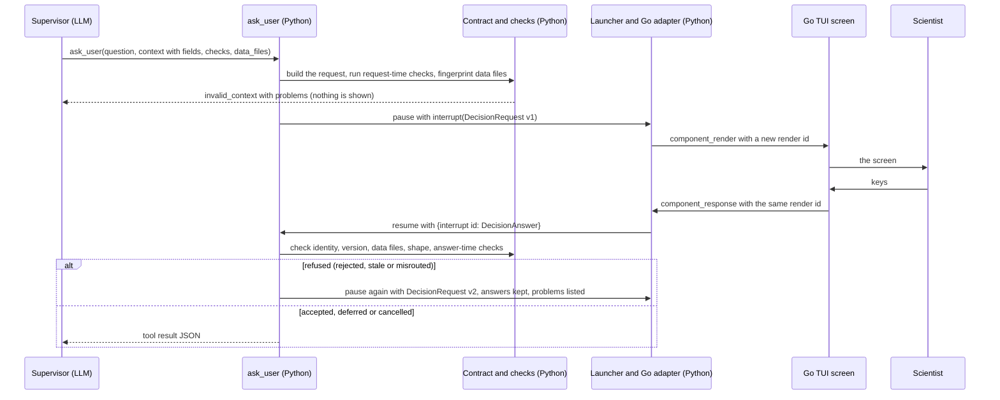
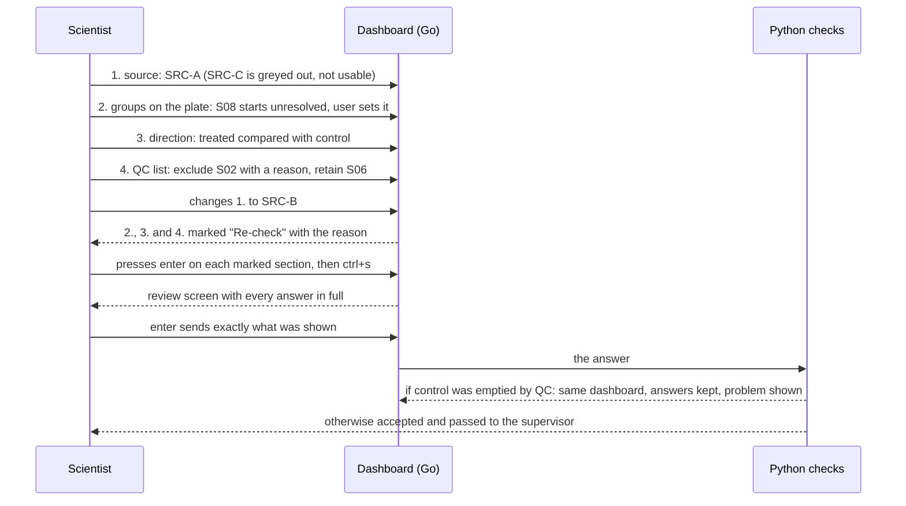
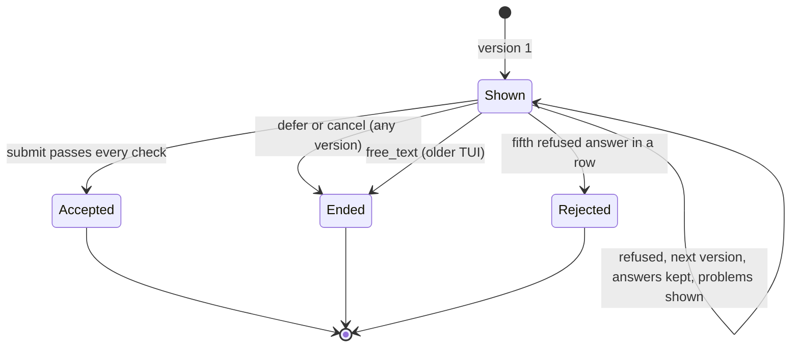
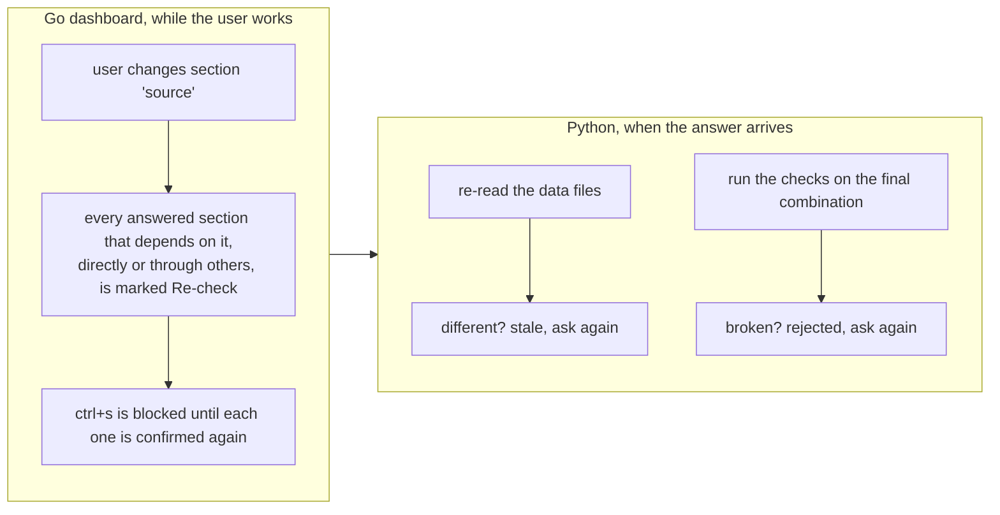

# Dynamic decision components (v1): design

Some analysis decisions belong to the scientist alone: which count table to use, which sample goes in
which group, which way round the comparison runs, which flagged samples to keep. In v1 the supervisor
asks these with `ask_user`, the local Go TUI shows each one as a proper screen, and Python checks
every answer before the supervisor sees it. If an answer breaks a rule, the same screen comes back
with the answers kept and the problem shown.

This document follows the code on the `dynamic-decision-components-v1` branch. Where it names a test,
the test exists under `tests/` or `lobster-tui/`. When the code and this document disagree, the code
is right and this document needs fixing.

---

## 1. Pictures first

### 1.1 The whole flow



The arrow from the contract back to the supervisor is the `invalid_context` result: the question was
malformed, so the user never sees it.

### 1.2 What changed compared with before

```mermaid
flowchart TB
    subgraph BEFORE["Before v1"]
        B1["ask_user guessed a widget from loose hints"] --> B2["the reply went to the supervisor unchecked"]
        B2 --> B3["the first reply on the bridge was taken, whatever it answered"]
        B3 --> B4["cancel ended the turn and the supervisor never heard of it"]
    end
    subgraph V1["v1"]
        V1a["typed question: fields with stable ids,<br/>ineligible options shown greyed with a reason"] --> V1b["answer checked in Python: identity, version,<br/>data unchanged, shape, named checks"]
        V1b --> V1c["refused answer: same question again,<br/>answers kept, problem shown"]
        V1c --> V1d["a reply must carry its screen's render id,<br/>cancel and defer reach the supervisor"]
    end
```



### 1.3 An example: treated versus control on one dashboard



---

## 2. Words used here

| Plain words | Term in the code | Where |
|---|---|---|
| The question as sent to a screen, with its identity and version | `DecisionRequest` | `lobster/services/interaction/component_schemas.py` |
| What a screen sends back | `DecisionAnswer` | same file |
| One thing to answer (a choice, a number, some text, a group of these) | field (`ChoiceField`, `NumberField`, `TextField`, `RecordField`) | same file |
| One option, or one sample a field is asked for | `Item` / `Option` | same file |
| A named rule the question carries, run by Python | check, from the `CHECKS` registry | same file |
| Asking the same question again after a refused answer | re-ask, `reask()` | same file |
| The graph pausing to wait for the user | LangGraph `interrupt()` | `lobster/tools/user_interaction.py` |
| One screen sent to the Go TUI | render, `component_render` message | `lobster/cli_internal/go_tui_launcher.py` |
| Turning a request into Go screens and Go replies into answers | the Go adapter | `lobster/cli_internal/go_tui_components.py` |
| Any program that shows the question (Go TUI, classic UI, later others) | surface | — |

---

## 3. The flow step by step

1. **The supervisor decides to ask.** `ask_user` and `get_dashboard_schema` are added to the
   supervisor's tools only in interactive mode (`lobster/agents/graph.py`). The `ask_user`
   description explains fields, items, views and checks; the views and checks parts are generated from
   the `VIEWS` and `CHECKS` registries (`test_docstring_lists_views_from_the_registry`,
   `test_docstring_lists_every_check_from_the_registry`). `get_dashboard_schema` returns the longer
   dashboard instructions only when the supervisor needs them.
2. **The question is built** (`_build_request` in `lobster/tools/user_interaction.py`).
   `map_question` (`lobster/services/interaction/component_mapper.py`) uses `context.fields` as given
   and validates it. Older hint-style context (`options`, `clusters`, threshold keys) is converted by
   rules (a threshold hint becomes a slider only when it gives both `min` and `max`; bounds are never
   invented, so otherwise the number is typed in; bounds written as text, `"0.05"`, are read), an
   ambiguous question can be formatted by an optional LLM, and anything else becomes one free-text
   field, whose `placeholder` hint is shown as its details, never filled in as the answer. A hint-style
   context keeps its `view`, `checks` and `data_files`, judged as on any context, never dropped
   (`test_hint_context_keeps_data_files_checks_and_view`). Then `check_request` runs the request-time checks once, and the files in
   `context.data_files` are fingerprinted. Any problem returns `invalid_context` with a list of
   problems, and nothing is shown (`test_invalid_context_never_pauses`,
   `test_bad_check_specs_never_pause`).
3. **The graph pauses.** `ask_user` calls `interrupt(request.to_wire())`. The id of the decision is
   `dec-<tool_call_id>-<8 random hex>` (section 4).
4. **The launcher collects every pending question** (`_handle_user_query`, `_handle_interrupts` in
   `go_tui_launcher.py`). It keeps reading after the first interrupt event, because the client yields
   one event per pending question. A `DecisionRequest` (schema `lobster.ask/1`) goes to
   `_answer_interrupt`. Any other payload goes through the existing `_handle_interrupt`, unchanged
   (`test_other_interrupt_payload_goes_through_upstream_handle_interrupt`,
   `test_single_other_interrupt_resumes_bare_through_handle_interrupt`).
5. **The adapter draws it** (`go_tui_components.py`). `unsupported()` first lists any shape this
   terminal can't draw. If there is one, the user gets an alert and the supervisor gets a `cancel` with
   a comment telling it not to retry the same shape. Otherwise `collect()` turns each field into one Go
   component (or a dashboard of them), and `_render_component` sends each one with a new render id and
   a `fallback_prompt`, then waits for the reply that carries that id.
6. **The Go TUI shows the screen** (`lobster-tui/internal/biocomp/{choice,choicelist,sampleplate,dashboard}/`,
   plus the existing `threshold_slider` and `text_input`). It replies in the component's own shape.
7. **The adapter turns the reply into an answer** (`_from_reply`, `build_answer`): the answer mirrors
   the fields, wrapped in an envelope that names the decision and the version it answers.
8. **The graph resumes** with `{interrupt_id: DecisionAnswer}`. Every pending question is answered and
   keyed by its own interrupt id (`test_two_pending_questions_each_get_their_own_answer`,
   `test_two_pending_decisions_answered_out_of_order`).
9. **`ask_user` judges the answer** (`_ask_until_settled`, `_judge`). An accepted answer, a defer or a
   cancel goes back to the supervisor as JSON. A refused answer produces the next version of the
   request and pauses again, inside the same tool call.

---

## 4. Identities: four ids that do different jobs

| Id | Made by | Looks like | What it is for |
|---|---|---|---|
| `decision_id` | `ask_user`, from the tool call id and a random part | `dec-<tool_call_id>-<8 hex>` | Which question this is. Stays the same across re-asks. An answer whose `responds_to.decision_id` differs is *misrouted*: never used, the question is asked again (`test_answer_for_another_decision_is_not_consumed`). |
| `request_version` | `ask_user` | `1`, `2`, … | Which version of the question. Goes up by one on every re-ask. An answer for another version is *stale* and is asked again (`test_answer_to_an_old_question_version_is_asked_again`). |
| LangGraph interrupt id | LangGraph | opaque string | Which paused `interrupt()` a resume value belongs to. The launcher keys answers by it. In LangGraph 1.2.16 (the locked version) a re-ask inside the same tool call pauses again under the same interrupt id; LangGraph 1.2.20 gives each re-ask a new one. Lobster's own ids don't depend on it. |
| Render id | the launcher, per screen | a UUID in the message id | Which screen a Go reply belongs to. A reply with another id is ignored (`test_stray_reply_to_an_old_render_is_ignored`). |

**Why Lobster mints its own id.** The id is Lobster's, not LangGraph's: it is built from nothing
inside LangGraph, whose interrupt-id formula has changed between versions. `_decision_id` adds 8 random
hex characters to the tool call id. The tool call id is set by the model provider, and some providers
number calls (`call_0`, `call_1`, …) and can repeat one inside one message, so the random part gives two
such calls two decisions, and each answer reaches its own
(`test_reused_tool_call_ids_get_their_own_decisions`, `test_decision_id_does_not_come_from_langgraph`).
The id is minted inside the build step, a LangGraph task (section 10), so the replay after a resume gets
the same id back from the checkpoint (`test_decision_id_is_the_same_on_replay`).

The answer also carries an `answer_id` (`ans-<uuid>`). It is passed to the supervisor for reference;
nothing deduplicates on it.

---

## 5. The contract

All of this lives in `lobster/services/interaction/component_schemas.py`. The supervisor writes only
the `context`; Python builds the envelope.

### 5.1 The request envelope

```json
{"schema": "lobster.ask/1",
 "decision_id": "dec-call_1-3f9a2c01",
 "request_version": 2,
 "actions": ["submit", "defer", "cancel"],
 "question": "Set up the treated vs control comparison",
 "view": "dashboard",
 "fields": ["... one entry per field ..."],
 "checks": [{"check": "each_option_kept", "field": "groups", "options": ["control", "treated"],
             "minus": {"field": "qc", "options": ["exclude", "defer"]}}],
 "problems": [{"path": "groups", "message": "'control' has no items left after removing S02 (Donor B) (qc: exclude)"},
              {"path": "qc", "message": "'control' has no items left after removing S02 (Donor B) (qc: exclude)"}],
 "snapshot": {"files": [{"path": "data/syn_rnaseq_SRC-A_author_counts.csv", "sha256": "…"}]},
 "prefilled_from_answer": true}
```

| Key | Meaning |
|---|---|
| `schema` | always `lobster.ask/1` |
| `decision_id`, `request_version` | see section 4 |
| `actions` | what the screen may send: `submit`, `defer` (decide later), `cancel` |
| `question` | one short line; the evidence goes in each field's `details` |
| `view` | `default`, or `dashboard` for several linked decisions on one screen |
| `fields` | what to answer (5.2) |
| `checks` | the named rules this question carries (5.6) |
| `problems` | why the previous answer was refused; each has a `path` (a field key such as `groups`, a row such as `qc.S02`, `data_files`, or an envelope key) and a `message` |
| `snapshot` | fingerprints of the data files, taken by Python, never written by the LLM (section 7) |
| `prefilled_from_answer` | `true` only when the defaults are the user's own previous answer; a surface may show defaults as "already answered" only then |

Tested by `test_envelope_wire_format` and
`test_request_carries_checks_problems_and_snapshot_on_the_wire`.

### 5.2 Fields

Every field is built from four types and two repeaters.

| Key | Meaning |
|---|---|
| `key` | the name the answer comes back under |
| `type` | `choice`, `number`, `text` or `record` |
| `question` | what to ask; a lone field may leave it out and use the main question |
| `details` | evidence or a recommendation, shown and never applied |
| `default` | a pre-filled answer, shaped exactly like the answer; for `for_each` it may cover only some items (`test_for_each_default_may_prefill_only_some_rows`) |
| `count` | `{"min", "max"}`: several values, the answer becomes a list |
| `for_each` | ask the same field once per item; the answer is keyed by item id |
| `view` | how to draw it (5.4); never changes the answer |
| `profile` | a named meaning from `PROFILES` (5.5) |
| `depends_on` | keys of sibling fields; changing one of them makes this field stale inside a dashboard (section 8) |

Per type: a `choice` has `options`, and an option may carry its own `fields`, shown only when that
option is picked (for example a reason for `exclude`). A `number` has value bounds `min`, `max`, plus
`integer` and `unit`. A `text` field is for answers that can't be listed or counted. A `record` asks
several sub-fields together.

A `key` is a plain name: it can't contain `.`, `[` or `]`, or start or end with a space, because problem
paths join keys with them (`qc.S02.fields.reason`, `treated[1]`), and a key holding one would point at
the wrong field (`test_a_key_that_would_break_problem_paths_is_refused`). A number answer must be finite:
NaN and infinity are refused, as NaN passes every bound (`test_a_number_that_is_not_finite_is_refused`).

### 5.3 Items and options

An item (an option, or an entry of `for_each`) is `{"id", "label", "details", "unavailable"}` or just a
plain string, which becomes the id. The **id** is the identity the answer uses (a sample ID, an
accession). The **label** is only for display and may repeat: two samples labelled "Donor A" are still
two samples (`test_repeated_labels_keep_distinct_ids`). An id can't start or end with a space, because
`S01` and `S01 ` look the same on screen (`test_an_item_id_with_spaces_at_an_end_is_refused`). An ineligible option or item is shown with
`"unavailable": "<reason>"` rather than left out: the screens show it greyed out with the reason, it
can't be picked, and an answer that picks it anyway is refused
(`test_unavailable_rows_are_not_answered`, `test_hint_option_marked_unavailable_stays_unavailable`).

### 5.4 Views: the `VIEWS` registry

A view asks for a richer drawing of the same answer.

| View | Applies to | Needs | Drawn as |
|---|---|---|---|
| `slider` | `number` | `min`, `max` | `threshold_slider` |
| `plate_map` | `choice` | `for_each` | `plate_map` (samples into groups on a 96-well plate, so up to 96 samples and 9 options; an option may ask one reason; larger groupings, items that aren't samples, or several picks per item use the per-item list) |
| `dashboard` | the whole question | at least 2 fields | `dashboard`, one section per field, with a review screen |

A dashboard section may be a choice (with or without `count`), a per-item choice on a plate, a
per-item list (one option per item; on both, an option may ask for one reason), a number or a text. It may not be a record, a choice whose options carry
other fields, or a per-item list with `count`
(`_check_dashboard`; `test_dashboard_refuses_sections_it_cannot_draw`,
`test_dashboard_allows_a_per_item_list_with_reason_fields`).

The Go adapter picks the component from the field, not only from the view:

| Field | Go component |
|---|---|
| choice | `choice` (a radio list for one pick, a checklist with `count`) |
| choice + `for_each` + `view: plate_map`, each option with no fields or one required text field (a reason), none unavailable | `plate_map`; the reason is typed on the plate (`test_plate_whose_option_needs_a_reason_is_a_plate_that_collects_it`) |
| the same, with an unavailable option | `choice_list`: the plate's legend has no place for an option shown greyed with its reason (`test_plate_with_an_unavailable_option_is_drawn_as_the_list`) |
| choice + `for_each`, no count, options with no fields or one required text field | `choice_list`: one screen, one row per item (`test_qc_review_is_one_choice_list_render`) |
| other choice + `for_each` shapes | one `choice` screen per item (`test_for_each_choice_with_count_keeps_one_render_per_item`) |
| number + `view: slider` | `threshold_slider`; a whole-number slider moves a hundredth of the range per key, shift a tenth, never less than 1 (`test_integer_slider_step_scales_with_the_range`) |
| number without slider, text | `text_input` (a typed number is parsed and asked again if invalid; thousands commas such as `2,000,000` are accepted; `nan`, `inf` and whole numbers above 2^53 are asked again, as the graph's checkpoint can't store a whole number past 64 bits) |

Numbers are shown as a person reads them, `2,000,000` or `0.31`, never `2e+06`: in the hints, the
classic prompts, the problems and the dashboard's review screen (`plain_number`, Go `plainNumber`).
| record | each sub-field in turn |

A sub-field asked on its own screen (a record's, or a picked option's when the list can't hold it) names
where it belongs, `Donor B (S02), Exclude: Why?`, and a re-ask starts it at the user's earlier answer
(`test_follow_up_names_the_item_and_option_and_keeps_an_earlier_answer`). On a typed-number retry the
reason goes above the whole question, so its bounds stay on screen.

**Keys.** The new screens (choice, per-item list, plate, dashboard) share one rule: enter submits, ctrl+d
defers, and esc asks first, so it takes esc twice to cancel; nothing is sent by a single esc. The
upstream slider and text screens are unchanged: one esc cancels, there is no defer key, and their help
line says `esc cancel`. On any question screen, ctrl+c cancels only that question and shows "Question
cancelled"; the turn goes on, so the supervisor gets the cancel and replies. A second ctrl+c cancels
the turn, as anywhere else (`TestCtrlCOnAQuestionCancelsOnlyTheQuestion`). Before, the same press
also cancelled the turn, which dropped the cancel from the conversation, so the supervisor redid the
original request on the next message.

### 5.5 Profiles, and the `record` type: available, not used by v1

`PROFILES` holds named meanings with their own check. It has one entry, `interval` (a record with
`from` and `to`; it checks `from <= to`). Like the `record` type, it is kept so future biology
(regions, intervals, time courses) fits the same contract. **No v1 flow uses either.** The supervisor's
`ask_user` description does not advertise profiles.

### 5.6 Checks: the `CHECKS` registry

A check is a small named rule with parameters. It knows nothing about RNA-seq: each one is generic, and
a domain rule is a combination of them. The supervisor attaches checks to a question in
`context.checks`. Python runs them; screens never do.

| Check | Runs | Parameters | Serves the rule |
|---|---|---|---|
| `each_option_kept` | on the answer | `field` (a per-item choice), `options` (option ids), optional `minus {field, options}` | each listed group keeps at least one item, also after the items given a `minus` option in the other field (for example QC `exclude` or `defer`) are taken out |
| `reason_required` | on the request | `field`, `options` | each listed option must carry a required text sub-field, so a reason can't be skipped |
| `no_default_for` | on the request | `field`, optional `items`, optional `options` | the default may not pre-fill these items (with these options): a suggestion or a warning never decides by itself |

**On the request** means: run once, by `ask_user`, on the supervisor's context, before anything is
shown; a failure is `invalid_context`. They never run inside the model validators, so a re-ask whose
defaults are the user's own answers can't trip them
(`test_request_checks_never_run_inside_model_validators`,
`test_reask_prefilled_with_the_users_own_answer_does_not_trip_no_default_for`).
**On the answer** means: run by `check_answer` after the shape checks. A check on a field whose shape
already failed is skipped, so the user sees one clear problem instead of noise
(`test_answer_checks_skip_a_field_whose_shape_failed`).

Example problem from `each_option_kept`, reported once on each field involved:
`'control' has no items left after removing S02 (Donor B) (qc: exclude)`
(`test_each_option_kept_rejects_a_group_emptied_by_qc_with_one_problem_per_field`,
`test_deferring_the_last_control_is_refused`).

**How to add a check: one registry entry.** Add an entry to `CHECKS` with four keys:

```python
CHECKS["my_check"] = {
    "on": "answer",            # or "request"
    "use_when": "field, ...: one line; it is copied into the ask_user description",
    "validate": _validate_my_check,   # (spec, fields) -> None, raises ValueError if the spec doesn't fit
    "run": _run_my_check,             # (spec, fields, answer) -> List[Problem]
}
```

`validate` runs whenever a question carries the check, so a malformed spec is refused before anything
is shown. `run` receives the top-level fields by key and, for answer checks, the cleaned answer. The
`ask_user` description lists the new check by itself. `test_checks_registry_holds_exactly_the_v1_checks`
pins the current set, so a new entry also updates that test, on purpose.

### 5.7 Answers mirror requests

```json
{"schema": "lobster.ask/1",
 "responds_to": {"decision_id": "dec-call_1-3f9a2c01", "request_version": 1},
 "answer_id": "ans-…",
 "action": "submit",
 "answer": {"source": {"id": "SRC-A"},
            "groups": {"S01": {"id": "control"}, "S08": {"id": "leave_out"}},
            "direction": {"id": "treated_vs_control"},
            "qc": {"S02": {"id": "exclude", "fields": {"reason": "low library size"}},
                   "S06": {"id": "retain"}}}}
```

| Field | Its answer |
|---|---|
| choice | `{"id": …}`, plus `"fields": {…}` for an option that has fields |
| choice with `count` | a list of those |
| number | a number (an `int` when `integer` is set) |
| text | a non-empty string |
| record | `{sub-key: answer}` |
| any field with `for_each` | `{item id: answer}` for every available item; unavailable items are never answered |

`action` is `submit`, `defer`, `cancel`, or `free_text`. The last one is never offered by a request:
it is how an older terminal sends the user's own words (section 11).

What the supervisor receives from `ask_user` (all JSON):

| `action` | Other keys | Meaning |
|---|---|---|
| `submit` | `decision_id`, `answer_id`, `answer`, `attempts`, optional `comment`, optional `changed_from_default` | checked and accepted |
| `defer`, `cancel` | `decision_id`, `answer_id`, `attempts`, optional `comment` | nothing decided; continue without a guess. A comment may say the terminal can't show a shape |
| `free_text` | `text`, `checked: false`, `note`, `attempts` | the user's own words, not checked; the note tells the supervisor to restate its understanding and confirm |
| `invalid_context` | `problems`, `note` | the question was malformed; nothing was shown |
| `rejected` | `decision_id`, `problems`, `attempts`, `note` | five answers in a row were refused; nothing decided |

`changed_from_default` lists, for a per-item single-choice field, each item the user answered differently
from the supervisor's default: `{"groups": {"S01": {"proposed": "control", "answered": "treated"}}}`. It
compares with version 1 of the question, because a re-ask's defaults are the user's own answers. An
item proposed without a default was open, not overridden. The description asks the supervisor to report
these as the user's overrides, so an override is never read as what the data said
(`test_picks_changed_from_the_default_are_reported_as_overrides`,
`test_overrides_compare_with_the_first_proposal_not_a_reask`). No reason is asked for.

### 5.8 A pinned leniency: a choice default may be a bare option id

The supervisor often wrote a choice default as `"SRC-A"` instead of `{"id": "SRC-A"}`. In the
measured sessions this made the first `ask_user` call fail in most runs. So a choice `default` may name
a known option by its bare id: `"SRC-A"`, per item `{"S02": "retain"}`, and with `count` a list of ids.
Python rewrites it to the full form before anything else sees it, so the wire always carries the full
form. This widens what the contract **accepts as input** from the supervisor. It does not change what it
sends, and **answers get no shorthand** (`test_bare_id_default_is_read_as_the_option`,
`test_bare_id_is_only_for_defaults_never_for_answers`,
`test_bare_id_default_goes_on_the_wire_in_full`).

---

## 6. Asking again



An answer is refused when:

| Kind | Why | Defaults on the next version |
|---|---|---|
| rejected | breaks the shape or an answer-time check | the user's submitted answer, where valid; for `for_each` every valid row is kept and only bad rows are dropped |
| stale (version) | answers another version | the submitted answer, where valid |
| stale (data) | a data file changed (section 7) | the submitted answer, with fresh fingerprints |
| misrouted | answers another decision | unchanged |
| malformed | not an answer at all | unchanged |

`reask()` sets `prefilled_from_answer` to `true` only when every default is the user's own: refilled
from the submitted answer, or already the user's. After a misrouted or malformed reply, an empty
answer (defer, cancel, free_text) or a partial one, some defaults are still the supervisor's proposals,
so no dashboard section starts ticked (`test_reask_says_whether_the_defaults_came_from_the_user`,
`test_reask_after_a_partial_answer_keeps_but_does_not_claim_the_rest`,
`test_misrouted_reask_shows_problems_but_no_section_is_answered`).

How the problems are shown:

- **every re-ask** starts with one line saying so: "Asked again (attempt 2 of 5): fix what is
  marked; your earlier answers are kept." ("kept" only when `prefilled_from_answer` is true). On the
  fifth attempt it adds that a refusal closes the question and nothing is decided
  (`test_last_attempt_says_a_refusal_closes_the_question`). The screen itself closes when the user
  submits; afterwards the supervisor, told `rejected`, is instructed to tell the user;

- **single question:** `⚠ <message>` lines at the top of the field's details; a problem in a row names
  the row (`test_reask_shows_problems_in_details_and_prefills`,
  `test_reask_of_a_choice_list_names_the_item_and_keeps_good_rows`);
- **dashboard:** each problem goes to the section its path starts with, the others go above the
  sections. A section with a problem starts unanswered but pre-filled; a section without one starts
  answered, so the user only fixes what failed
  (`test_reasked_dashboard_routes_problems_and_sends_every_previous_answer`, Go
  `TestProblemsAreShownAndThoseSectionsStartUnanswered`,
  `TestSectionsWithAnAnswerStartAnsweredAndAppearOnReview`);
- **classic UI:** printed before the prompts.

Rules of the loop (`_ask_until_settled` in `lobster/tools/user_interaction.py`):

- `defer` and `cancel` end the call at any version, as long as the decision id matches and the action
  is allowed: nothing is applied, so the version doesn't matter
  (`test_defer_and_cancel_end_the_call_even_for_an_old_version`).
- After **five refused answers in a row** (of any kind), the supervisor gets `rejected` with the last
  problems, so a screen or a user that keeps sending the same bad answer can't loop forever
  (`test_five_rejections_in_a_row_return_rejected`).
- A `free_text` answer is never re-asked (`test_free_text_answer_is_marked_unchecked_and_not_reasked`).
- The whole journey is one tool call. The full path with a real checkpointed graph and a fake TUI is in
  `test_full_path_every_control_excluded_is_reasked_then_accepted`.

---

## 7. Data files and fingerprints

The question may name the workspace files it is about in `context.data_files` (workspace-relative
paths). When asking, Python computes a sha256 fingerprint of each file and stores it in the request's
`snapshot`. Paths must stay inside the workspace: absolute paths, `..` and links leading out are
refused, and so is a missing file or anything that isn't a regular file, such as a pipe, which would
block the read (`invalid_context`; `test_fingerprint_refuses_a_pipe_instead_of_waiting_on_it`). Without an open workspace, `data_files` is
refused too (`test_untrusted_or_missing_data_file_is_invalid_context`,
`test_data_files_without_a_workspace_is_invalid_context`).

**Without `data_files`, Python watches the workspace's `data/` folder:** every regular file in it and
its subfolders (hidden files and links skipped, at most 500 files) is fingerprinted when the question
is built, so a change to the file a question was built from is caught even when the supervisor named
none; a named `data_files` list watches only those files, and files added during the question are
ignored (`test_without_data_files_the_data_folder_is_watched`).

**Two kinds of fingerprint.** A sha256 reads every byte: exact, but about 280 MB/s on a laptop, paid
when the question is asked and again on submit. Size and modification time (`quick`) is instant but
misses a change that keeps both (e.g. a copy that preserves the old time). So:
- **named `data_files`** (what the decision is about) are read in full up to **1 GB** (about 4 s),
  `quick` above it, so a huge `.h5ad` or BAM never freezes a question for minutes;
- **the `data/` folder watch** (a safety net over up to 500 files) reads in full only files up to
  **1 MB** (sample sheets, small tables), `quick` above it, so the whole watch stays around a second
  or two (`test_the_folder_watch_reads_only_small_files_in_full`,
  `test_a_big_unnamed_file_is_watched_by_size_and_time`).

When a `submit` arrives, Python reads the files again, each the way it was recorded (`refingerprint`):
a file recorded by size and time is compared by size and time, whatever its size now. If any differs, the answer is stale with the
problem `the data changed while you were reviewing it: <path>`, and the question comes back with fresh
fingerprints and the answers kept (`test_data_edited_before_submit_is_asked_again_with_answers_kept`).
A deleted file stays stale until it is back; defer, cancel and the five-refusal limit still apply
(`test_deleted_data_file_is_stale`). The screen never echoes the fingerprints: Python is the only
authority. The fingerprints are part of the cached request, so a replay doesn't re-read the files
(`test_replay_reuses_the_cached_fingerprints`).

---

## 8. Two kinds of "stale": the dashboard's and the data's



| | Dashboard staleness | Data staleness | Checks |
|---|---|---|---|
| Computed by | Go (`biocomp/dashboard`) | Python | Python |
| From | the request's `depends_on` | the files' fingerprints | `context.checks` |
| Knows any science? | no | no | no (generic checks) |
| Guarantees | a section made stale by an upstream change can't be submitted until the user looks at it again | an answer to changed data is never accepted | the final combination passes every attached check |

Python does not re-check the dashboard's staleness (it can't know in which order the user answered).
Go does not run checks. Each side guarantees its own part. Go tests:
`TestChangingUpstreamMakesEveryDependentStale`, `TestAnsweringUpstreamAfterDownstreamAlsoMarksStale`,
`TestResubmittingTheSameAnswerChangesNothing`.

The dashboard also refuses to submit while a section is unanswered or shows unsaved changes, and shows
a **review screen** that renders exactly the reply Enter will send
(`TestUnsavedDraftBlocksSubmit`, `TestReviewScreenShowsExactlyTheReplyAndEnterConfirms`).

---

## 9. Duplicates and late replies: prevented by structure

There is no idempotency store. Duplicates can't be consumed because of how the pieces fit:

| Hazard | What stops it | Test |
|---|---|---|
| A late reply to an earlier screen taken as this screen's answer | the render id must match | `test_stray_reply_to_an_old_render_is_ignored` |
| The same reply sent twice | after the first, the screen's id is gone: the next screen ignores it, and the main loop ignores a reply when no question is shown | `test_duplicate_reply_after_resume_is_ignored_by_the_next_render`, `test_duplicate_reply_after_the_turn_is_ignored_by_the_main_loop` |
| One answer consumed by two pending questions | LangGraph resumes each pending interrupt once, keyed by interrupt id | `test_two_pending_decisions_answered_out_of_order` |
| Several questions pending without interrupt ids, so their answers would overwrite each other | the launcher sends nothing, and says so in an alert (the classic UI refuses too) | `test_several_questions_without_ids_are_refused_not_merged` |
| A resume keyed by an id that isn't pending | reaches the pending pause as a malformed answer and is asked again | `test_resume_with_a_non_pending_interrupt_id` |
| An answer for another decision | misrouted, asked again, never used to pre-fill | `test_answer_for_another_decision_is_not_consumed` |

---

## 10. Replay: build and judge run once

LangGraph pauses `ask_user` by raising inside `interrupt()`. On resume it runs the whole function
again, and each earlier `interrupt()` returns its recorded answer. Without care, that replay would
build the question again. The LLM formatting path could build a *different* question, and the data
files would be read again, so an answer could be judged against a question the user never saw.

So the two steps a replay must not repeat, building the question (`build_question`) and judging an
answer (`judge_answer`), run as LangGraph tasks (`_once` in `lobster/tools/user_interaction.py`).
The checkpoint keeps each task's result, and the replay gets that result back instead of running the
step again. Both steps take and return plain data, which is what a checkpoint stores. Outside a graph
(a direct tool call) they simply run. An LLM call inside either step must carry the `nostream` tag,
or the chat stream shows it as a sub-agent working (`component_mapper.py` does this)
(`test_replay_reuses_the_cached_request`, `test_replay_after_a_rejection_still_uses_the_first_build`,
`test_replay_in_an_async_graph_still_uses_the_first_build`, `test_replay_reuses_the_cached_fingerprints`).

---

## 11. Fallbacks

**A shape this terminal can't draw.** Today that means `count` on a field that isn't a choice (a list of
numbers, texts or records), at any depth. In the Go TUI it also means the shapes its screens refuse to
start with: a plate with more than 9 options or more than 96 samples, a plate or per-item list whose
items are all unavailable, and a slider whose `min` equals its `max`, alone or as a dashboard section
(`test_unsupported_lists_the_shapes_the_go_screens_refuse`). The user sees an alert. The supervisor
gets `cancel` with the comment `Not answered: this terminal can't show <what>. Don't ask again with the
same shape; ask in chat or with a shape it can show.`
(`test_question_the_terminal_cannot_draw_is_cancelled_with_a_reason`,
`test_cannot_show_comment_tells_the_supervisor_not_to_retry_the_shape`,
`test_plate_the_go_screen_would_refuse_is_cancelled_before_rendering`). A dashboard with a `count`
section that isn't a choice is already refused at request time.

**A screen that fails anyway.** If the Go TUI replies that it couldn't show a component (its start-up
check or its drawing failed), the user sees `Couldn't show the question: <detail>`. The supervisor gets
`cancel` with the same kind of comment, `Not answered: this terminal can't show this question
(<detail>). Don't ask again with the same shape; …`, so it never reads as the user's own cancel
(`test_component_error_is_reported_and_cancels_the_question`).

**An older Go TUI** that doesn't know `choice`, `choice_list`, `plate_map` or `dashboard` shows its
text box instead. Every render carries a `fallback_prompt` with the whole question in plain words: the
question, on a re-ask the same "Asked again (attempt n of 5)" line the screens show, any problems, each field (each dashboard section, in order) with its details, items and
options as `id — label: details (unavailable: reason)`, then "Write your answer in your own words."
(`test_fallback_prompt_states_the_whole_question`,
`test_every_render_carries_the_whole_question_as_fallback_prompt`). The typed reply becomes a
`free_text` answer. `ask_user` returns it with `checked: false` and a note asking the supervisor to
restate how it understood the answer and confirm before acting
(`test_older_tui_text_box_reply_resumes_as_free_text`,
`test_full_path_older_tui_text_answer_is_unchecked_free_text`). Because of this, `lobster-ai` and the
`lobster-ai-tui` binary should be released together.

**The classic UI** (`lobster chat --ui classic` or `--classic`; `--verbose` and `--reasoning` also
switch to it) asks a `DecisionRequest` as plain-text prompts (`classic_interaction.py`): numbered
options (unavailable ones listed and refused), comma-separated numbers for several picks, one prompt per
available item, a `Reason:` prompt for an option that needs one, numbers asked again until valid, and
dashboard sections in order followed by a summary and `Confirm all? [y/N]` (`y` or `yes` sends; `n`,
`no` or Enter defers; anything else asks again, so a typo doesn't throw the answers away:
`test_dashboard_confirm_asks_again_on_anything_but_yes_or_no`). `d` defers and `q` cancels at any
prompt. A lone `d` or `q` typed at a text prompt also means defer or cancel. It
reuses the Go adapter's translation, so the answer is the same envelope and the same checks and re-asks
apply (`test_classic_answers_go_through_the_checks_and_reask`). It has no staleness markers and no
review screen.

**Other interrupts** (payloads that are not a `DecisionRequest`) take the existing path, unchanged.

---

## 12. What each layer guarantees

| Layer | Guarantees | Does not guarantee |
|---|---|---|
| `ask_user` description and `get_dashboard_schema` | tell the supervisor how to ask, when to show ineligible items, to ask the direction of a comparison, which checks exist | that the supervisor asks, attaches checks, or asks the direction: that is model behaviour |
| Contract (`component_schemas.py`) | a malformed question is never shown; an answer is accepted only if it answers this decision and version, the data is unchanged, every available item is answered, nothing unavailable or unknown is picked, and every attached check passes | rules the question didn't carry |
| `ask_user` loop | a refused answer never reaches the supervisor; it is asked again with answers kept; at most five refusals in a row; a replay judges against the question that was shown | anything across separate `ask_user` calls |
| Launcher | every pending question is asked and answered under its own interrupt id; only a reply with the screen's render id is taken; an unanswered screen waits with no deadline; cancel, defer, a screen error and a fault while asking resume the supervisor with the reason, and the screen is closed; quit and a closed TUI end the turn | durability across restarts |
| Go adapter | never draws a broken screen; unavailable items are never wells or answer rows; problems are shown; every render has a plain-words fallback | — |
| Go components | unavailable options can't be picked; a plate can't be sent with unresolved samples; a list can't be sent with a missing option or reason; a dashboard can't be sent while a section is unanswered, stale or unsaved; the review screen shows exactly what will be sent; text wraps instead of being cut | the checks (Python's job) |
| Classic UI | the same answers, checks and re-asks | staleness markers, review screen |

---

## 13. Limits, stated plainly

- **Checks run only when the question carries them.** The supervisor attaches them. In the measured
  sessions it attached all three dashboard checks every time on the dashboard prompt, and
  `reason_required` in two of three runs of the QC prompt. A question without a check is checked for
  shape only.
- **Checks never span separate questions.** A check sees one submitted answer: one question or one
  dashboard. "Don't empty a group after the QC exclusions" is enforced only when groups and QC are
  answered together, on one dashboard.
- **The direction question is asked by the supervisor, not enforced.** The `ask_user` description tells
  it to ask, as its own choice field, which group is compared with which, whenever items are split into
  groups (`test_docstring_asks_for_the_direction_of_a_group_comparison`). No check requires it.
- **A question waits for its answer with no deadline.** A run without an answer stays paused for as
  long as the process lives; nothing cancels it or continues with a default. The wait ends only when the
  user answers, defers, cancels or quits (`test_decision_request_waits_with_no_deadline`,
  `test_unanswered_question_stays_open_until_the_tui_goes`, end to end E20). When something fails
  while the question is open, the question is never dropped silently: Python sends `component_close`
  (the screen's render id and a reason), the TUI removes the screen and shows `This question was
  closed (<reason>); nothing was sent.`, and the supervisor resumes with `cancel` and the comment `Not
  answered: the question was closed (<reason>); nothing was decided. Ask again if it is still needed.`
  A fault is named by its type only
  (`test_a_fault_while_asking_closes_the_screen_and_tells_the_supervisor`).
  If the TUI itself has exited, the wait ends at once and the turn ends without resuming: nobody is
  there to read the supervisor's reply (`test_a_closed_tui_ends_the_wait_at_once_without_resuming`).
  Whenever a turn ends with a question still drawn, the TUI removes it and says `This question was
  closed; nothing was sent.`, so a screen can't be answered after nothing reads it
  (`TestTurnEndRemovesALeftoverScreen`, `TestComponentCloseRemovesTheScreenAndSaysWhy`).
- **The plate map's grid needs 48 columns.** Crust draws only the grid; the question, legend and
  current-well line are drawn by the plate and wrap at the width
  (`TestOnlyCrustsGridAndNoLineIsWiderThanTheScreen`). It assigns with number keys, so it takes 1 to
  9 options and holds at most 96 samples (unavailable ones take a well too). A plate beyond either
  limit is cancelled with the "can't show" comment before it is drawn (section 11).
- **Without colour, the dots look alike.** Every group is a `●`; colour tells them apart. `n`
  switches the wells to each option's number, in its colour, for a terminal without colour or a
  reader who can't tell the colours apart (`TestNSwitchesTheWellsToNumbersAndBack`).
- **The plate's flag review is not used.** The plate can force a review of flagged wells, but the
  adapter never marks a well as flagged, so a warned sample on a plate is not forced into review. Ask
  warned samples with the per-item list (or a `no_default_for` check) instead.
- **Long lists get slower to draw.** One key press and frame on the per-item list takes about 10 ms at
  72 rows, 30 ms at 200 and up to 55 ms at 500 (measured, machine-dependent). Fine for v1's sizes; past
  200 items, caching each row's wrapped height would be needed.
- **`record` and `PROFILES` are available, not used by v1** (5.5).
- **The bare-id default is a deliberate leniency** in the input (5.8).
- **The supervisor prompt is unchanged.** A line asking the supervisor to prefer `ask_user` over
  questions in chat was measured in 63 real sessions (21 without it, 21 with each of two wordings). It
  changed nothing on any prompt: the improved `ask_user` description was already enough. So the line
  was dropped.
- **Nothing outlives the checkpoint.** No decision store, no idempotency store. The versions shown
  live in the graph's checkpoint as task results (10). The CLI's checkpoint is in memory, so a restart
  loses the paused question with the rest of the run; a host with a persistent checkpointer keeps it.
- **A data change re-asks with every answer kept.** The "the data changed" problem is shown above the
  dashboard's sections, and each section starts answered with the user's earlier answer, so the user
  can send the same answers again without opening a section.
- **Known terminal limits (not fixed in v1):**
  - A terminal resize does not reach `lobster-tui` as the launcher starts it (its own session,
    `os.setsid`, unchanged from upstream), so the screen keeps its starting size
    (`test_e27_resize_reaches_the_binary_as_the_launcher_starts_it`, a strict xfail).
  - In inline mode on a terminal 6 to 9 rows tall, a question's frame is 10 lines, taller than the
    terminal, so its top scrolls off.
- **Go tests outside CI.** The upstream workflows run `go test ./internal/chat ./internal/protocol
  ./internal/initwizard`, so the new `biocomp` tests run only locally (`cd lobster-tui && go test ./...`).
- **Dependency.** `lobster-tui` requires `github.com/the-omics-os/crust` for the plate map. See
  "Crust dependency" below: the plate now needs an unreleased Crust change.

### The plate map

The plate puts each sample into one group (`plate_map`). What it shows, and why:

- **Groups on the grid.** Each well is drawn by Crust's Groups view: `●` in its group's colour, `◉`
  when it has a reason, `!` after it when it needs a reason, `○` (orange) unresolved, `◌` (grey) can't
  be assigned, `·` no sample. Group colours are Crust's category palette, in option order; orange
  and grey are the plate's own status colours, so a group never looks like a warning. The legend pairs
  each number key with its dot: `1 ● vehicle   2 ● TDX-9   3 ● leave out (asks a reason)   0 ○
  unresolved` (`TestGroupsAreDotsWithMarksAndTheLegendNamesTheKeys`). The cursor's row letter and
  column number are bold and underlined, a blank line separates the plate from the lines under
  it, and `n` switches the dots to option numbers.
- **Reasons on the plate.** An option with one required text field (a reason) opens a one-line box on
  the current-well line under the plate: `D2  X02 → leave out · Why leave it out: █`; the plate
  stays visible. An empty reason is refused; esc puts the sample back to its previous option. An
  item's `warning` (its own field; `items_from` reads it from a column) is shown greyed as a hint
  that tab inserts; it is never filled in by itself. `r` edits a saved reason. Enter is refused while a
  sample is unresolved or lacks its reason; the message names the wells and the cursor moves to the
  first. Reasons come back keyed by sample id and become the option's fields, the list's answer
  shape; a re-ask and a dashboard prefill start with them; the review screen lists every reason
  (`reasons_test.go`, `test_plate_reasons_become_the_options_fields`).
- **Real wells.** An item may carry `position` (`"D1"`, or `{"row": "D", "column": 1}`), and the
  sample is drawn there. Positions are given for every item or none; a position outside A1 to H12
  or two samples in one well are refused (`test_plate_positions_are_checked`). Without positions,
  wells are filled in list order and the plate says these are not the physical positions.
- **Samples that can't be assigned** (an unavailable item: a QC pool, a blank) sit greyed in their
  wells, with the reason on the current-well line, and are never in the answer. From a table,
  `items_from.unavailable: {"column", "values": {value: reason}}` marks them.
- **A label that already holds the id** is shown alone (`TW.M07 (well C2)`, not `TW.M07 (well C2)
  (TW.M07)`), on the plate, in the list, on the review screen and in the classic UI.
- **`items_from`.** Instead of writing out up to 96 ids, positions and defaults, the supervisor names
  the columns of a workspace CSV or TSV: `"items_from": {"file", "id", "default", "label",
  "details", "position", "warning", "where", "unavailable", "match"}`. Python reads it when
  the question is built (`expand_items_from`, called by `ask_user`), so every screen gets an
  ordinary `for_each`, and the file is added to `data_files`. The field keeps its `items_from`:
  when the data changes while the user reviews it, the re-ask reads the table again
  (`reread_items`): positions and items come from the new file, answers are kept for ids still
  there, new rows start unresolved, and new and vanished ids are named in problems; a table that
  can no longer be read keeps the old items and its old fingerprint, so the answer stays stale
  (`test_a_changed_table_is_read_again_on_the_reask`). More than 96 rows on a plate says "a plate
  holds at most 96 samples; leave the view out to ask them as a list". A `default` value that isn't an option (blank, `?`, `unknown`)
  proposes nothing, so the sample starts unresolved. A missing file or column, a blank or repeated
  id, no matching rows, or more rows than the view takes (96 on a plate, 500 otherwise) return
  `invalid_context`: nothing built from a broken table is shown (`test_items_from.py`). Nothing in it
  is specific to a modality: it reads sample sheets, plate layouts, channel maps, cluster tables and
  ASV lists alike, for the list as well as the plate.
- **When the supervisor uses the plate.** The `ask_user` description, the view's own description and
  `get_dashboard_schema` say: plate_map to put samples into groups, one group each, up to 96 samples
  and 9 options; ask over all the samples (known groups pre-filled, uncertain ones empty), not just
  the uncertain few; prefer `items_from` when the samples are in a file; use the list for more than
  96 items or 9 options, items that aren't samples, several picks per item, options needing more
  than one reason, or items with their own option lists
  (`test_the_supervisor_is_told_when_to_use_the_plate`). The groups example uses `items_from`
  with `view: plate_map`, and the supervisor is told not to restate counts in its text (the
  screen counts). When a per-item question that could be a plate pre-filled no item, the result
  carries the note "ask over all the samples, with the known ones pre-filled, so the user sees
  them in context" (not when a `no_default_for` check covers the field, as in a QC review).
- **A removal always asks a reason.** An option marked `"removes": true` takes the item out, so
  `check_request` returns `invalid_context` unless it has a required text field: `option 'batch_2'
  takes something out (removes: true): give it a reason field`. `"removes": false` says it doesn't,
  whatever its name. An unmarked option is checked by its id and label as a safety net (remove,
  exclude, drop, discard, omit, leave out, not included): `option 'omit' sounds like it takes
  something out: give it a reason field, or mark it "removes": false if it doesn't`, so a name that
  only sounds like one (`dropout_cells`, `removed_batch_effect`) is one key away from passing. It
  doesn't depend on a `reason_required` check (`test_removes_true_needs_a_reason_whatever_the_name`,
  `test_removes_false_lets_a_name_that_only_sounds_like_one_through`).
- **Decimal sliders move in round steps.** The adapter sends a step from the decimals in `min` and
  `max` (0.50 to 0.99: 0.01), ten times finer until there are at least 20 positions (0 to 1: 0.01);
  the slider puts every value on `min + k × step`, rounded to the step, so 0.75 is reachable and steps
  never drift (`test_a_decimal_slider_gets_a_round_step`, `TestValuesLandOnTheStepGrid`).
- **The "ask over all" note is for groupings only.** It reads "When samples are being put into groups,
  ask over all of them; never pre-fill exclusions or QC decisions." and is added only to a per-item
  question that fits a plate and has at least two options that are groups, not a removal or a QC
  verdict (retain, keep, defer, flag, review, pass, fail), so a keep/exclude review never gets it
  (`test_a_qc_review_gets_no_note`).
- **A single choice shows no pick it doesn't have.** Every row is `( )`; the cursor is the `>`
  pointer; `(●)` marks only a real default (`TestASingleChoiceShowsADotOnlyForItsDefault`).
- **The result says why a question came back.** A result after a re-ask carries `reasked_because`:
  the problem messages of every re-asked version, in order, once each (for example `the data changed
  while you were reviewing it: data/layout.csv`), so the supervisor can explain it
  (`test_the_result_says_why_the_question_came_back`). After the five-refusal limit, the note also says
  "Don't ask the same question again in this turn; tell the user what failed first." When the
  supervisor asks again itself, the guidance tells it to put the user's earlier answers in `default`.
  An empty `for_each` next to `items_from` counts as left out.
- **Context sent as text.** A `context` that is JSON text for an object is read as that object;
  other text is refused with `invalid_context` (`test_context_sent_as_json_text_is_read`).
- **No chat box under a question.** While a question is on screen (inline mode too), the chat box
  is hidden and gets nothing: a paste meant for a reason used to land in it as well
  (`TestAQuestionHidesTheChatBoxAndKeepsPastesOutOfIt`). This applies to the older question
  screens too.
- **Hidden list rows are counted.** When rows of the per-item list are scrolled out of view, a dim
  `↑ N more` / `↓ N more` says so (`TestHiddenRowsAreCountedAboveAndBelow`).

### Crust dependency

**The plate needs a Crust change that is not released yet.** Crust v0.1.0 draws every sample as `.`,
with no way to show a group. The Groups view (`platemap.ViewGroups`, `Well.Group`, `Noted`,
`Flagged`, `Excluded`, `PlateData.Groups`, `Theme.Groups`, `WithGridOnly`, `GroupColor`) is on the
Crust branch `platemap-groups-view` (with `WithGroupNumbers` and the focused row and column
headers bold and underlined), written to be offered to the Crust repository as its own pull
request. Until Crust merges and releases it and `lobster-tui/go.mod` requires that version, this
branch's `lobster-tui` **does not build against the `go.mod` as committed**. Locally it builds
with an uncommitted `lobster-tui/go.work` that uses the Crust branch; that file is never committed.
Once Crust is released: bump the `require` in `go.mod`, delete `go.work`, and run
`cd lobster-tui && go test ./...`.

---

## 14. What other surfaces will need (Ink, browser, Cloud)

The contract doesn't depend on the Go TUI. A new surface needs:

1. **A renderer per component**, or its own equivalent of each: a choice (radio and checklist), a
   per-item list with inline reasons, a plate or grid for per-sample choices, a slider, a text box, and a
   dashboard with dependency staleness, a review screen and per-section problems. Each must show
   `unavailable` items greyed with their reason and never let them be picked, and must honour
   `prefilled_from_answer`.
2. **The same contract.** Read a `DecisionRequest`, send a `DecisionAnswer` with `responds_to`. Leave
   checking to Python: a surface may refuse incomplete input, but the rules live in `CHECKS`.
3. **A host adapter for pause and resume**, like the Go launcher: deliver each interrupt payload, key
   each answer by its interrupt id, accept only the reply to the screen that is showing, and decide what
   timeout, quit and cancel mean for the turn. A networked host, where replies can be retried, will
   probably need deduplication on `answer_id`; v1 has none.
4. **Its own fallback** for shapes it can't draw (cancel with a comment, as `cannot_show` does) and a
   plain-text path, like `fallback_prompt` and `free_text`.

---

## 15. Where things live

| File | Role |
|---|---|
| `lobster/services/interaction/component_schemas.py` | the contract, `VIEWS`, `PROFILES`, `CHECKS`, `check_answer`, `reask`, fingerprints |
| `lobster/services/interaction/component_mapper.py` | supervisor context → fields |
| `lobster/tools/user_interaction.py` | `ask_user` (build, pause, judge, re-ask, cache), `get_dashboard_schema` |
| `lobster/agents/graph.py` | adds both tools in interactive mode |
| `lobster/cli_internal/go_tui_components.py` | the Go adapter, `fallback_prompt`, `unsupported` |
| `lobster/cli_internal/go_tui_launcher.py` | pending questions, render ids, the wait (no deadline) and `component_close` |
| `lobster/cli_internal/classic_interaction.py` | plain-text prompts |
| `lobster-tui/internal/biocomp/choice/` | `choice` |
| `lobster-tui/internal/biocomp/choicelist/` | `choice_list` |
| `lobster-tui/internal/biocomp/sampleplate/` | `plate_map` (on Crust's plate map, Groups view; see "Crust dependency") |
| `lobster-tui/internal/biocomp/dashboard/` | `dashboard` and the review screen; `testdata/` holds the Python ↔ Go fixtures |
| `docs/dynamic-ui/demo/make_synthetic_rnaseq.py` | the fictional 8- and 72-sample datasets |
| `docs/dynamic-ui/demo.md` | how to run all of it |

Main tests: `tests/unit/services/test_component_schemas.py`, `tests/unit/services/test_component_mapper.py`,
`tests/unit/tools/test_user_interaction.py`, `tests/unit/cli/test_go_tui_components.py`,
`tests/unit/cli/test_go_tui_launcher_completions.py`, `tests/unit/cli/test_classic_interaction.py`,
`tests/unit/cli/test_go_tui_turn_outcomes.py`, and the Go tests next to each component. The Python ↔ Go
round trip (`test_dashboard_data_matches_the_go_fixture`, `test_go_dashboard_reply_becomes_a_valid_answer`,
Go `TestPythonFixtureRoundTrip`, `TestPythonReaskFixtureRoundTrip`) proves both sides agree on the wire.
